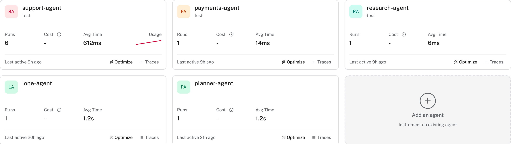
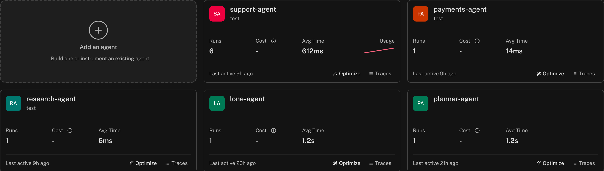
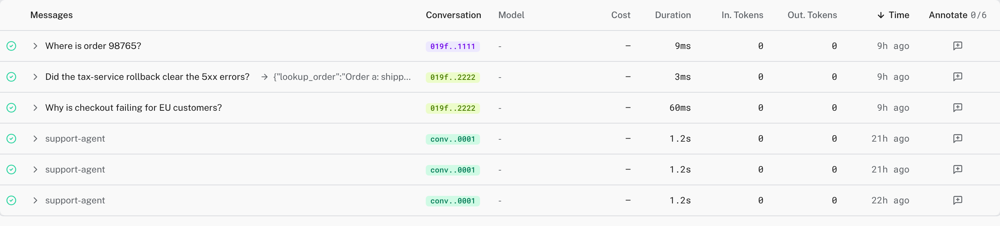
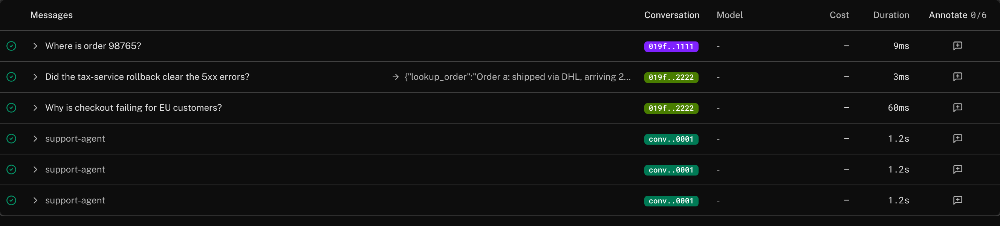
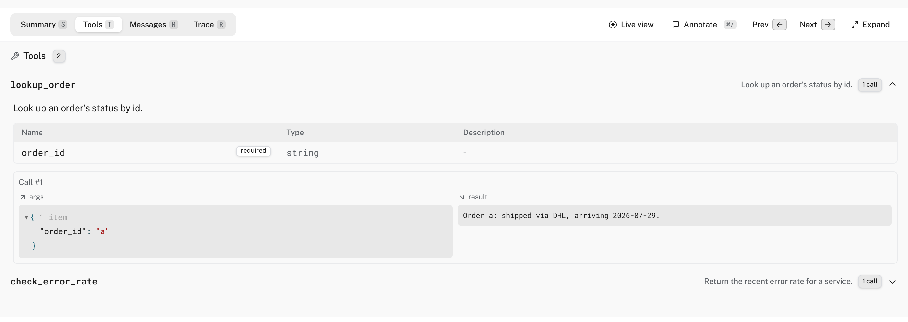
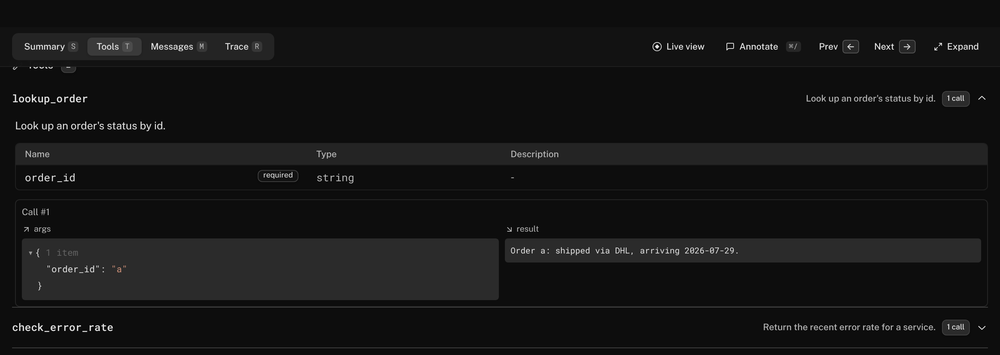
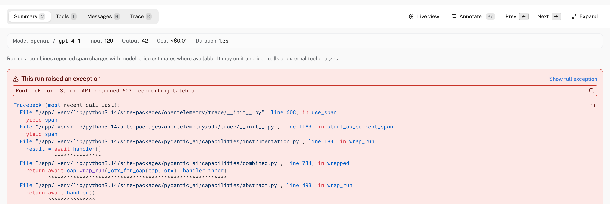
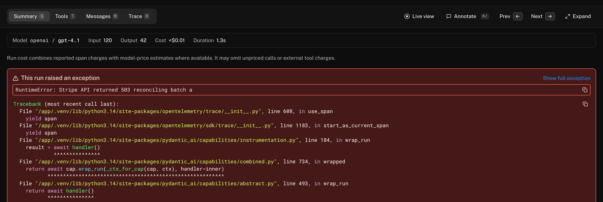

# Agents

The **Agents view** is the entry point for finding and inspecting the AI agents running in your application. Logfire discovers an agent automatically from your traces: any span that follows the [OpenTelemetry semantic conventions for generative AI (GenAI) agents](https://github.com/open-telemetry/semantic-conventions-genai/blob/main/docs/gen-ai/gen-ai-agent-spans.md), specifically an `invoke_agent` operation (`gen_ai.operation.name = 'invoke_agent'`), becomes an agent run. [Pydantic AI](https://ai.pydantic.dev) emits these spans natively, and any other SDK that follows the conventions appears here too. Logfire also detects agents instrumented with [OpenInference](https://github.com/Arize-ai/openinference), which covers many popular frameworks; see [Supported frameworks](#supported-frameworks).

{{ video("02eb69ba8023a4f13c5ee3fbaf11ec48", 95, 56) }}

You'll find Agents in the project sidebar. The time picker is shared with the rest of the observability surfaces.

## The Agents list

Each agent detected in the selected time window appears as one row, with its run count, cost, token usage, and when it was last active. Click a row to open that agent's detail page.

<!-- ladle-screenshot story="product--agents--agent-list--docs-agent-cards" image="../../images/agents/agents-list" alt="The Agents list, one card per detected agent" viewport="1400x800" scale="2" selector="[aria-label='Agent cards']" aspect="1377:390" padding="0" time="2026-07-19T12:00:00Z" -->

<!-- /ladle-screenshot -->

If you don't see an agent you expect, widen the time range: the list only reflects agent activity in the current window.

## Supported frameworks

Logfire detects agent runs from several telemetry conventions:

- **OpenTelemetry GenAI** (`gen_ai.operation.name = 'invoke_agent'`): [Pydantic AI](https://ai.pydantic.dev) emits these natively, as does any SDK that follows the [GenAI agent conventions](https://github.com/open-telemetry/semantic-conventions-genai/blob/main/docs/gen-ai/gen-ai-agent-spans.md).
- **OpenInference** (`openinference.span.kind = 'AGENT'`): frameworks instrumented with [OpenInference](https://github.com/Arize-ai/openinference), including LangGraph, CrewAI, smolagents, Agno, and the OpenAI Agents SDK for Python.
- **OpenLLMetry** (`traceloop.span.kind = 'agent'`): agents wrapped with Traceloop's `@agent` decorator.
- **Framework-specific attributes**: Logfire recognizes the root spans emitted by Genkit and VoltAgent.

Detection only determines whether a run appears in this curated Agents view. It does not determine whether Logfire supports or can ingest the framework's OpenTelemetry: that data remains available in Live and Explore. Model, token, cost, tool, and message fields depend on the attributes and trace relationships emitted by the framework. See [agent framework coverage in Logfire](../../integrations/agent-frameworks/support-matrix.md) for the current experience with each integration.

!!! note "Cost for OpenInference-detected agents"
    The current reader does not populate aggregate agent cost from OpenInference model spans, so these agents show no cost in the Agents list and the **Metrics** tab. An individual run's **Summary** can still estimate cost from a recognized model and token counts.

!!! note "OpenInference prompts and tools"
    The **Info** tab can show a system prompt reconstructed from OpenInference input messages. The **Tools** tab can show definitions when the instrumentor records `llm.tools.*.tool.json_schema`. The full **Messages** tab does not yet read OpenInference message attributes.

See the integration guide for your framework to set up the instrumentation that produces these spans.

## Agent detail

The detail page has these tabs:

- **Metrics**: run volume, error rate, latency, cost, and token usage for the agent over time.
- **Runs**: every individual run of the agent (see below).
- **Info**: the agent's model, tools, and other metadata.
- **Optimize** (Beta): reviews the agent's recent runs, weighting failing runs highest, and proposes changes to its system prompt that you can refine. This tab appears when AI features are enabled for your organization.

## The Runs tab

The Runs table lists one row per agent run, newest first, with:

- **Messages**: a preview of the run's latest user prompt and its final output. For a run that continues a conversation, this is the current turn's question, not the conversation's opening message.
- **Conversation**: a colored chip grouping runs that belong to the same conversation. Click a chip to filter the table to that conversation. Runs are grouped by `gen_ai.conversation.id`; Pydantic AI sets this per run and carries it forward when you pass `message_history`, so a multi-turn conversation stays together.
- **Model**, **Cost**, **Duration**, **In / Out tokens**, and **Time**.

Search the message text, or open **Filters** to narrow by model, cost, duration, token counts, or annotation state. Failed runs are marked with an error icon.

<!-- ladle-screenshot story="product--agents--runs-table--docs-runs-table" image="../../images/agents/runs-table" alt="The Runs tab, one row per agent run" viewport="1500x800" scale="2" selector="div:has(> table)" aspect="1329:300" padding="0" time="2026-07-19T12:30:00Z" -->

<!-- /ladle-screenshot -->

## Reviewing a single run

Click a row (or its `>` chevron) to expand the run detail inline; the **Expand** button opens the same view full screen. Move between runs with the **Prev / Next** buttons or the `[` and `]` keys, and jump between tabs with `S` / `T` / `M` / `R`.

A run detail has four tabs:

- **Summary**: a strip of the run's provider, model, token usage, cost, and duration; an AI-generated summary of what the run did (when AI features are enabled for your organization); and the run's input and final output.
- **Tools**: a combined view of the tools the agent had available and how it used them. Each tool shows its parameter schema and a count of how many times it was called, and expands to the arguments and result of every call.
- **Messages**: the full conversation for the run.
- **Trace**: the underlying span tree, so you can drop into the raw trace.

<!-- ladle-screenshot story="product--agents--run-details--view--tools-tab" image="../../images/agents/run-tools" alt="A run's detail panel, with the Tools tab showing each tool's schema and calls" viewport="1400x800" scale="2" aspect="1327:472" padding="0" time="2026-07-19T12:30:00Z" -->

<!-- /ladle-screenshot -->

If a run failed, a banner at the top of the Summary tab surfaces the exception type, message, and traceback, so you can see why it failed without leaving the page.

<!-- ladle-screenshot story="product--agents--run-exception-banner--stripe-reconcile-failure" image="../../images/agents/run-error" alt="The exception banner on a failed run" viewport="1400x800" scale="2" aspect="1295:435" padding="0" time="2026-07-19T12:30:00Z" -->

<!-- /ladle-screenshot -->

## Annotating a run

From a run's detail panel you can record a human judgment of its quality: a verdict, category, tags, and a comment. See [Annotate an agent run](../../evaluate/annotate-agent-runs.md) for the full workflow. These editable [run annotations](../../evaluate/human-review.md) remain separate from automated [evaluation results](../../evaluate/overview.md). Run annotations are in Beta.

## Next steps

- [Annotate an agent run](../../evaluate/annotate-agent-runs.md): record a verdict, comment, and tags on a run.
- [Human Review](../../evaluate/human-review.md): the wider picture on scoring AI outputs by hand.
- [Pydantic AI](https://ai.pydantic.dev): the agent framework that emits these spans natively.
