# Dashboards

This guide explains how to use dashboards in the Logfire UI to visualize your observability data. Dashboards allow you to create custom visualizations using SQL queries.

There are two types of dashboards:

- **Standard dashboards** are built and maintained by the Logfire team. You turn them on for your project, and they get updates without any work from you. You can't edit them, but you can [duplicate one](#duplicate-or-export-a-dashboard) into a custom dashboard. See [Standard dashboards](standard-dashboards.md).
- **Custom dashboards** are dashboards that you build, from scratch or from a copy of another dashboard.

Start with the standard dashboards. If they don't answer your question, [duplicate one](#duplicate-or-export-a-dashboard) or build your own.

## View a dashboard

Open <OpenInLogfire path="dashboards" variant="inline" label="Dashboards" /> for your project and click a dashboard to open it.

### Choose the time range

The time range picker in the top right controls the window of data that every panel shows. Pick a preset from **Last 15 minutes** to **Last 7 days**, or open **More granular options** for ranges such as **Last 3 hours** and **Last 30 days**. The buttons below the presets select a calendar period, such as **Today** or **Previous week**. **Custom range** sets an exact start and end.

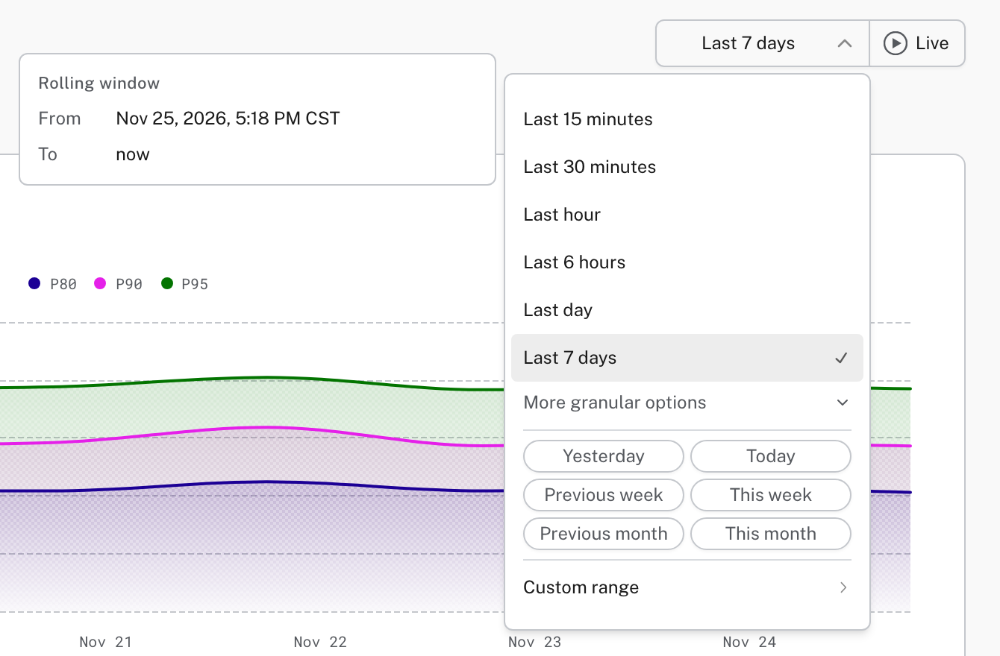

Turn on **Live** next to the picker to keep the dashboard current. Logfire runs the panel queries again on an interval matched to the time range, between 15 seconds and 1 minute, and the time window moves forward with the clock. Logfire remembers the **Live** setting for each dashboard in your browser. Picking a calendar period or a custom range turns **Live** off.

Pausing **Live** freezes the time window, so you can inspect the data without it moving. Resuming follows the clock again.

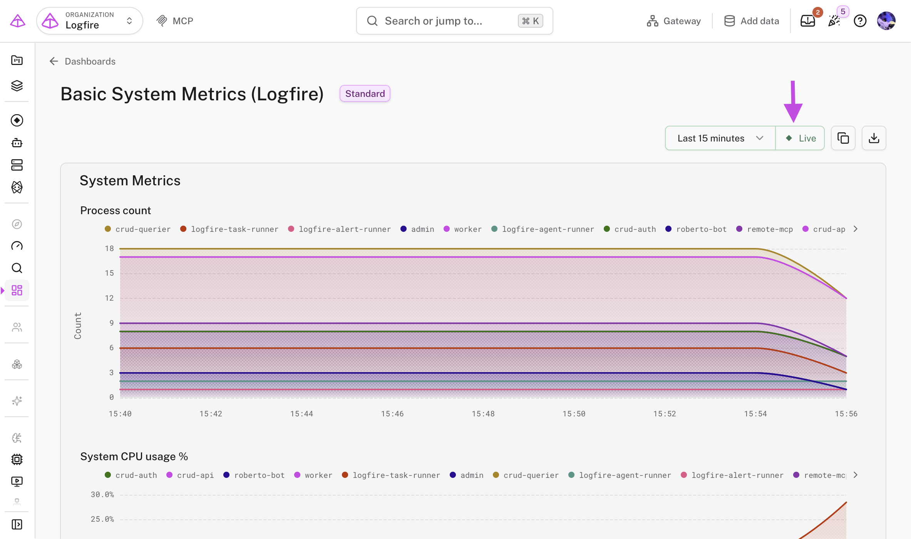

### Filter with variables

The selectors at the top of a dashboard, and sometimes inside a panel group, are [variables](#filter-a-dashboard-with-variables). Pick a value to filter the panels that use it. When a selector is not at its default value, click its **Reset to default** button to put it back.

### Look closer at a panel

Each panel has a menu in its top right corner:

- **View full screen** shows the panel on its own. Click **Exit full screen** to go back.
- **View queries** shows the SQL behind the panel.

In a table, hover over a cut-off value to read all of it. A `trace_id` value links to the trace in [Live View](live.md).

### Duplicate or export a dashboard

Click **Duplicate dashboard** (the copy icon) in the top right to make a custom dashboard from the one you're viewing. Enter a name, which defaults to "Copy of" followed by the original name, and confirm. Logfire creates the copy with the same panels, variables, and layout, and opens it. The copy is a snapshot: later changes to the original don't reach it.

To copy a dashboard into another project, or to keep it in version control, export it as JSON. Click **Export dashboard** (the download icon) to open a side panel with the dashboard's JSON, then click **Copy JSON** or **Download JSON**. See [Work with the dashboard JSON](#work-with-the-dashboard-json).

## Build a custom dashboard

### Create a dashboard

1. Open <OpenInLogfire path="dashboards" variant="inline" label="Dashboards" /> and click **New Dashboard**.
2. Select the **Custom** tab.
3. Choose **From scratch**, or **Import JSON** to paste a dashboard you exported.
4. Enter a name and click **Create Dashboard**.

A dashboard from scratch starts empty. It is made of:

- **Panels**: blocks containing a data visualization built from a SQL query.
- **Panel groups**: named sections that hold related panels. Viewers can collapse them.
- **Variables**: selectors that filter what the panels show.

### Edit a dashboard

Click **Edit** in the top right of a custom dashboard. In edit mode:

- The dashboard title becomes an editable text field.
- The **Edit dashboard** side panel opens. Use it to add panels, panel groups, and variables, or to edit the dashboard's JSON.
- Each panel, group, and variable shows buttons to edit, move, or remove it.

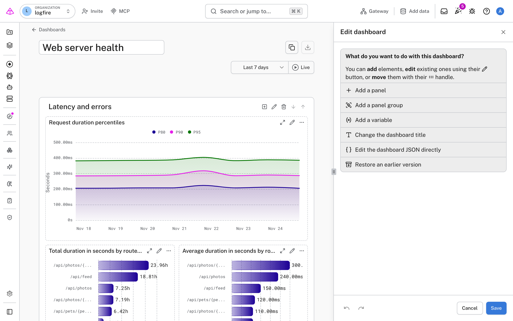

Your changes stay in your browser until you click **Save**. If your current time range, refresh setting, or variable selections differ from the dashboard's saved defaults, the save dialog asks which of them to keep as the new defaults.

**Cancel** puts the dashboard back the way it was when you clicked **Edit**. If you made changes, Logfire asks you to confirm first. If you leave the page without saving, Logfire keeps a draft in your browser and reopens it in edit mode the next time you open the dashboard there.

If someone else saves the same dashboard while you edit it, Logfire tells you. You can then keep their version or overwrite it with yours.

#### Undo and redo

Click the undo and redo arrows at the bottom of the **Edit dashboard** side panel to step back and forward through your changes. The keyboard shortcuts are `Cmd+Z` and `Cmd+Shift+Z` on macOS, and `Ctrl+Z` and `Ctrl+Y` on Windows and Linux.

To take back one change without losing the changes you made after it, hover over your reply to it in the side panel and click **Undo this choice**. Click **Redo this choice** to bring it back.

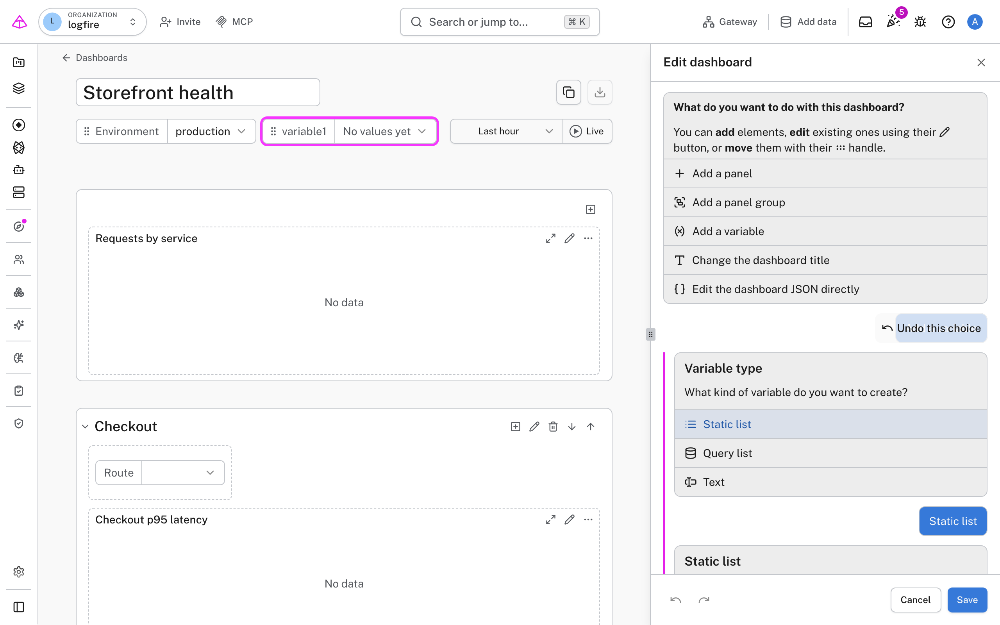

### Add panels

In edit mode, click **Add a panel** in the side panel, or the **Add panel to group** button on a panel group. Then pick the type of panel:

| Group         | Panel type        | What it shows                                            |
| ------------- | ----------------- | -------------------------------------------------------- |
| Time series   | **Lines**         | A line over time for each series                         |
| Time series   | **Bars**          | Bars over time, one for each series in each time bucket  |
| Stats         | **Values**        | One large number for each series or column               |
| Stats         | **Gauge chart**   | A dial for each series, measured against a maximum       |
| Comparisons   | **Bar chart**     | One bar for each series or row                           |
| Comparisons   | **Pie chart**     | One slice for each series, sized by its value            |
| Comparisons   | **Radar chart**   | One axis for each category and one shape for each series |
| Comparisons   | **Scatter chart** | One point for each row, placed on two numeric axes       |
| Text and data | **Table**         | Every row and column that the query returns              |
| Text and data | **Markdown**      | Text, links, and images, with no query                   |

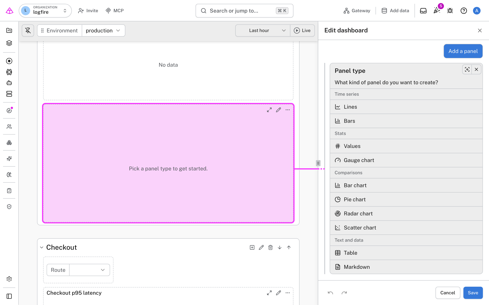

The panel then opens with a **Title** field and a SQL editor holding an example query for that panel type. Replace the query with your own and run it. Logfire reads the result columns to set up the panel. For example, it picks a unit for durations, and on a time series it offers to split the values into one series for each value of a text column.

**Lines** and **Bars** need a timestamp column for the time axis, usually grouped into intervals with `time_bucket($resolution, start_timestamp)`. See [Resolution variable](#resolution-variable).

```sql
SELECT
    time_bucket($resolution, start_timestamp) AS x,
    count() AS count
FROM records
GROUP BY x
```

Other panel types don't need a timestamp column. This query fits a **Bar chart** or a **Table**:

```sql
SELECT
    count() AS count,
    span_name
FROM records
GROUP BY span_name
ORDER BY count DESC
LIMIT 10
```

For query recipes and the patterns that suit each panel type, see [Write dashboard queries](../../how-to-guides/write-dashboard-queries.md). The [SQL reference](../../reference/sql.md) and the [metrics schema](explore.md#metrics-schema) list the data you can query.

#### Change a panel

After the query runs, the side panel offers options for that panel type, such as **Change the unit and format**, **Change the bar layout**, or **Change the chart colors**. Each option opens the settings it names. Two options are on every panel: **Change the query** and **Change what kind of panel this is**.

To change a panel later, click its **Edit** button. The panel menu also has **Duplicate** and **Delete**.

A **Values** panel can show a health status bar under each value, so you can see at a glance whether a number is healthy. Pick **Add a health status bar**, then set the value at which each state starts. The states are **Healthy**, **Warning**, and **Critical** by default, and you can add your own. To mark lower values as worse, such as for a cache hit rate, give **Healthy** the highest value.

#### Move and resize panels

In edit mode, drag a panel by its title bar to move it.

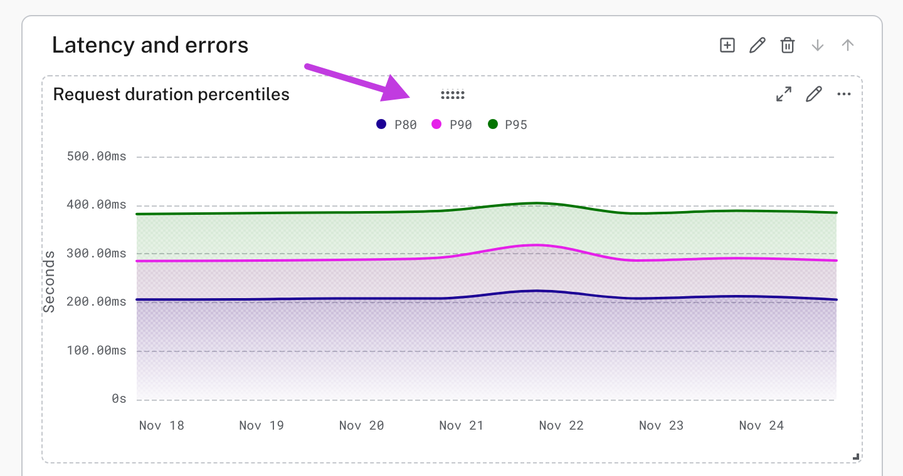

Drag the bottom right corner of a panel to resize it.

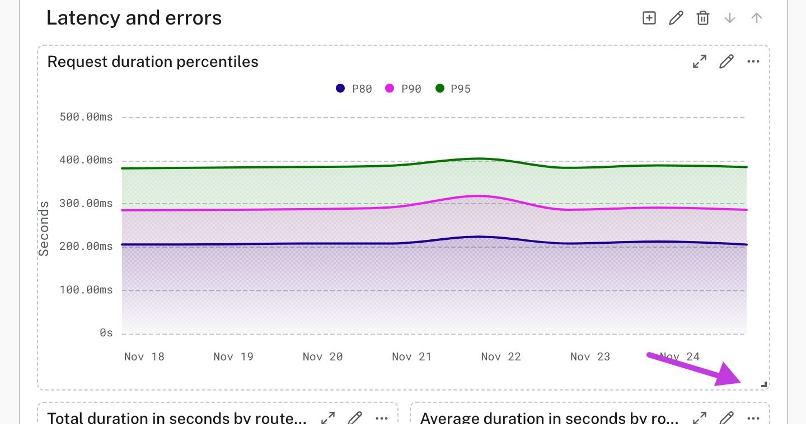

### Organize panels into groups

Panel groups keep related panels together, such as an overview at the top and a detailed section below it. To add one, click **Add a panel group** in the side panel. Logfire adds the group with a placeholder title, which you can change.

Each group's header has buttons to add a panel, rename the group, delete it, and move it up or down the dashboard.

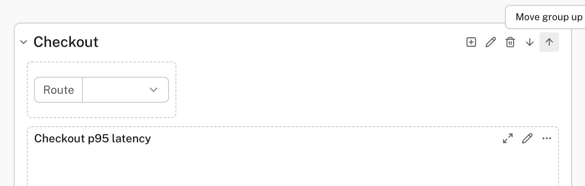

When a dashboard has more than one titled group, viewers can collapse each one. Collapsing a group doesn't change the saved dashboard. To make a group start collapsed, set its `display.collapse.open` to `false` in the [dashboard JSON](#work-with-the-dashboard-json).

## Filter a dashboard with variables

Variables let you change what a dashboard shows without editing its queries. You define a variable once, reference it in your SQL queries as `$variable_name`, and Logfire adds a selector for it to the top of the dashboard.

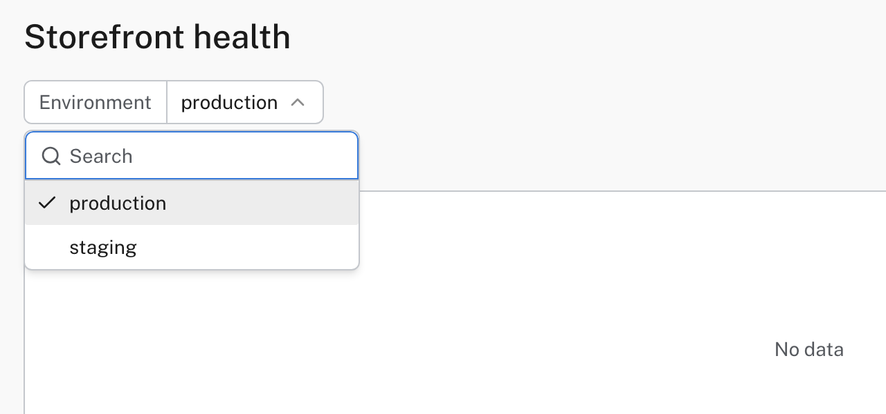

To add a variable to a custom dashboard:

1. Open the dashboard and click **Edit** in the top right.
2. Click **Add a variable** in the **Edit dashboard** side panel, then pick the variable type.
3. Fill in the variable's settings. Its selector appears in the dashboard toolbar as you go.
4. Click **Save**.

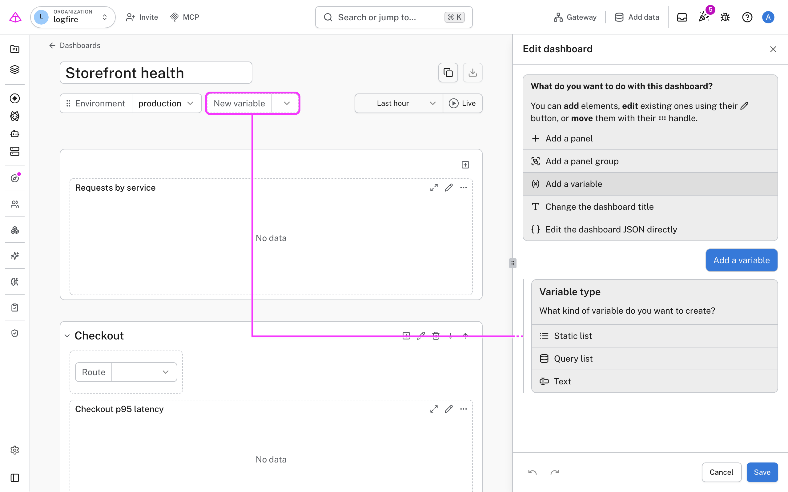

To change a variable later, hover over its selector in edit mode and click **Edit variable**.

Each variable has a **Name** (how you reference it in queries) and an optional **Label** shown on its selector. There are three variable types:

- **Static list**: viewers pick from a dropdown of values that you type in. Use it for a short list that doesn't change, such as environments.
- **Query list**: viewers pick from a dropdown of the values that a SQL query returns. Use it for values that change with your data, such as service names.
- **Text**: viewers type any value into a text box. Use it for a value with no fixed list, such as a search term.

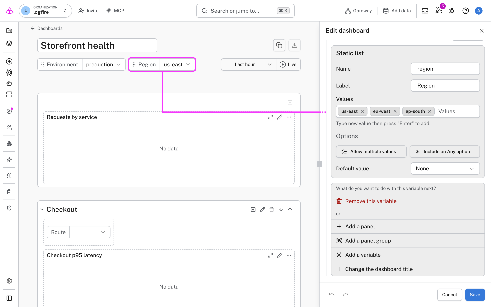

### List variables

A query list keeps the dropdown in sync with your data automatically. The query must return exactly one column, and each distinct non-null value becomes an option. For example, if your metrics record a `tenant_id` attribute, this query fills the dropdown with every tenant ID captured on the `api.requests` metric:

```sql
SELECT DISTINCT attributes->>'tenant_id'
FROM metrics
WHERE metric_name = 'api.requests' AND attributes->>'tenant_id' IS NOT NULL
ORDER BY 1
```

If the query returns no values, the selector shows **No Data** and can't be changed.

List variables have a few more settings:

- **Allow multiple values**: viewers can select several options at once. The variable then resolves to a list of values in SQL, which changes how you compare it: see [Use variables in queries](#use-variables-in-queries).
- **Include an Any option**: adds an **Any** entry that leaves the filter off. Your query has to handle it: see [Use variables in queries](#use-variables-in-queries).
- **Default value**: the option viewers see when they first open the dashboard.

### Set variable defaults

Each variable has a default value that viewers see when they first open the dashboard. To change it, set **Default value** in the variable's settings. Or enter edit mode, pick the value you want in the toolbar selector, and click **Save**. The save dialog asks whether to keep the new selection as the default.

### Filter one panel group

A variable can also sit in the dashboard grid as a control, next to the panels it filters. A control in a titled panel group filters only the panels in that group, and the toolbar and other groups are unaffected. This is useful for dashboards that mix overview panels with a detailed group, where a toolbar variable that filters everything would be too broad. A control in an untitled group filters the whole dashboard, like a toolbar variable.

To move a variable into the grid, hover over its selector in edit mode and click **Move to dashboard**. Then drag the control into the group you want. To put it back, click **Pin to toolbar** on the control.

Queries reference a control's variable with the same `$variable_name` syntax as any other variable.

Dashboards made with the earlier panel variables show each one as a control above its panel. That control filters every panel in its group.

### Use variables in queries

Reference a variable anywhere in a panel's SQL query as `$variable_name`, or `${variable_name}` if the name would otherwise run into the text after it:

```sql
SELECT count() FROM records WHERE service_name = $service_name
```

Write the variable bare, without quotes. Logfire sends the selected value separately from the query and inserts it as a properly quoted SQL value. Writing `'$service_name'` in quotes would search for the literal text `$service_name` instead.

A variable with **Allow multiple values** turned on resolves to a list of values rather than a single one. Compare it with `= ANY(...)` instead of `=`:

```sql
SELECT count() FROM records WHERE service_name = ANY($service_name)
```

When a viewer selects every option, the variable resolves to the list of all of them, so the `ANY` comparison above matches them all.

A variable with **Include an Any option** turned on needs one more step. When a viewer picks **Any**, or clears every option on a multiple-value variable, the query receives the placeholder `__logfire_all_values__` in place of a real value. Write the query to skip the filter when it sees that placeholder:

```sql
SELECT count()
FROM records
WHERE ($service_name = '__logfire_all_values__' OR service_name = $service_name)
```

For a multiple-value variable, the placeholder arrives as a one-item list:

```sql
SELECT count()
FROM records
WHERE (array_has($service_name, '__logfire_all_values__') OR service_name = ANY($service_name))
```

To send a different placeholder, pick **Set the value sent for Any** among the variable's options in the side panel.

Variables can only be used in SQL queries. They can't be used in panel titles or other settings.

When a query uses variables, tick **Show rendered query** in the panel's SQL editor to see it with all the values filled in. This is useful for copying a query somewhere variables don't exist, like the [SQL Workbench](explore.md).

### Built-in variables

Every dashboard provides some variables automatically. You can use them in any dashboard query without defining anything.

#### Resolution variable

All dashboards have access to a special `$resolution` variable that holds a time interval, like `1 minute`, matched to the dashboard's time range. Use it to group timestamps into buckets for time series charts:

```sql
SELECT
  time_bucket($resolution, start_timestamp) AS x,
  count(1) as count
FROM records
GROUP BY x;
```

Logfire picks the resolution automatically to balance detail against query cost, and it adjusts as the time range changes.

#### Time range and context variables

These variables describe the dashboard's current time range and where it lives:

| Variable                                 | Value                                                                                    |
| ---------------------------------------- | ---------------------------------------------------------------------------------------- |
| `$__from`, `$__to`                       | Start and end of the time range, as Unix millisecond timestamps                          |
| `$__from_iso_string`, `$__to_iso_string` | Start and end of the time range, as ISO 8601 timestamps in UTC                           |
| `$__range`                               | Length of the time range as human-readable text, e.g. `1 hour`                           |
| `$__range_s`, `$__range_ms`              | Length of the time range in seconds and in milliseconds                                  |
| `$__organization`, `$__project`          | Names of the current organization and project                                            |
| `$__dashboard_slug`                      | The dashboard's URL slug                                                                 |
| `$__envs`                                | The environments selected in the environment filter, as one comma-separated string       |
| `$resolution`                            | The automatic time bucket interval for the time range, see [above](#resolution-variable) |

## Restore an earlier version

Logfire keeps the earlier versions of a custom dashboard, so you can go back after a save that you want to revert.

1. Open the dashboard and click **Edit**.
2. Click **Restore an earlier version**. The option only appears once the dashboard has an earlier version.

   

3. The **Version history** list shows the current version, then each earlier version with its age and who saved it. Click a version to preview it on the page. Nothing is saved while you preview.

   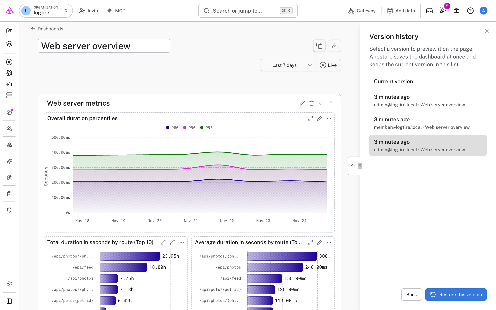

4. Click **Restore this version**.

A restore saves immediately. It doesn't wait for **Save**, and it discards any unsaved edits you made before opening the version history. If you have unsaved edits, Logfire asks you to confirm first.

A restore is itself a new version, and Logfire keeps the version it replaced. To undo a restore, open the version history again and restore the most recent earlier version.

A restore brings back the dashboard's name, panels, variables, and layout.

### Which versions are kept

Logfire keeps up to 50 of the most recent versions of a dashboard. Older versions are removed as new ones arrive, and the most recent earlier version is always kept. A restore always keeps the version it replaces. So does overwriting someone else's changes after a save conflict.

A run of saves by the same person keeps at most one version every five minutes, so a burst of small edits shows up as a single entry.

For extremely large or complicated dashboards, Logfire may save less than 50 total revisions to avoid storing too much data. The vast majority of users are unlikely to hit this limit.

### Restore from the API, MCP, or the Logfire Assistant

The same three operations are available outside the dashboard editor: list the kept versions, read one, and restore one.

- **Public API**: with a [Logfire API key](../../reference/advanced/use-api-keys.md), under `/api/v1/projects/{project_id}/dashboards/{dashboard_id}/`, use `GET versions/`,`GET versions/{version}/`, and `POST versions/{version}/restore/`. Reading needs the `project:read_dashboard` scope and restoring needs `project:write_dashboard`. To make a restore fail if someone else changed the dashboard after you read it, send the dashboard's current version as `{"version": <current version>}`. The request then returns `409` instead of overwriting their change.
- **MCP server**: the [Logfire MCP server](../../how-to-guides/mcp-server.md) has the `dashboard_list_versions`, `dashboard_get_version`, and `dashboard_restore` tools.
- **Logfire Assistant**: ask it to put a dashboard back the way it was, or to show what a dashboard looked like before a change. It asks for your approval before it restores anything.

## Work with the dashboard JSON

Every dashboard is stored as a JSON document. This is the same format the [Terraform provider](../../how-to-guides/infrastructure-as-code.md) uses, and the format you import when you create a custom dashboard from JSON.

- In view mode, click **Export dashboard** to open a side panel with the dashboard's JSON. Click **Copy JSON** or **Download JSON**. The dashboard stays interactive while the panel is open. Export isn't available in edit mode until you save.
- In edit mode, click **Edit the dashboard JSON directly** in the side panel. Edits apply to the dashboard as you type. Logfire validates the JSON against the dashboard schema and shows the first problem below the editor. Invalid JSON isn't applied: the dashboard keeps the last valid version. Changes under `metadata` aren't saved.

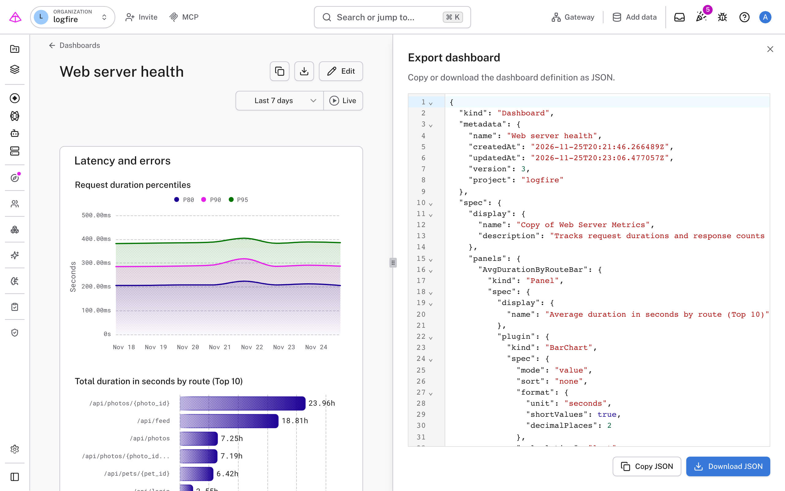

## Next steps

- [Standard dashboards](standard-dashboards.md) to see the ready-made dashboards you can turn on.
- [Write dashboard queries](../../how-to-guides/write-dashboard-queries.md) for query recipes for each panel type.
- [Infrastructure as Code](../../how-to-guides/infrastructure-as-code.md) to manage dashboards with Terraform.
