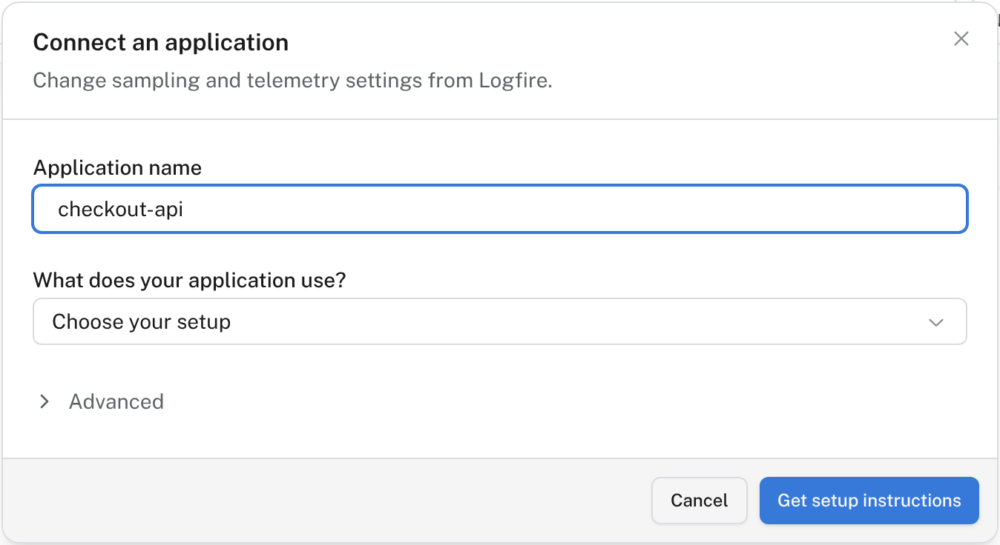
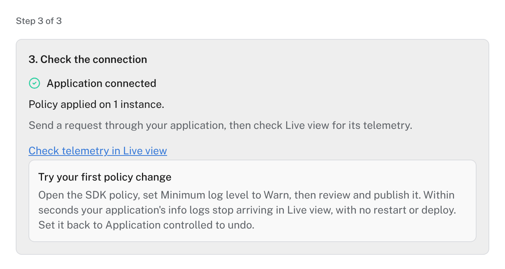
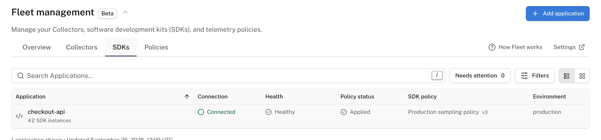

# Manage applications

!!! note "Beta"

    Fleet is in beta and can change between releases.

Change what a running application records and sends: its sampling rate, minimum log level, redaction and scrubbing, and which signals it exports. You change these from Logfire, with no restart or redeploy.

Each application takes its settings from an **SDK policy**. A policy sets only the settings you choose; every other setting stays as the application configured it ("Application controlled"). See [Change policies](policies.md).

## Before you start

- Your application already sends data to Logfire, with a [write token](../../../how-to-guides/create-write-tokens.md) in its environment. Fleet doesn't change how it sends data: it changes the SDK's settings.
- You can load a small Fleet package into the application, as shown below for each language.

## Connect an application

1. In **Fleet management**, open **SDKs** and select **Add application**.
2. Enter the application's name, which becomes its `OTEL_SERVICE_NAME`, and choose what it uses. Select **Get setup instructions**.

    

3. Install Fleet support and load it, as Logfire shows for your setup:

    === "Python with Logfire"

        Requires Python 3.11+ and Logfire 5.5.0 or a later 5.x release. If you are upgrading from 4.x, read the [5.x upgrade notes](../../../release-notes.md#upgrading-from-4x-to-5x) first.

        ```bash
        pip install --upgrade 'logfire[fleet]'
        ```

        Add `fleet=True` to your `logfire.configure()` call. Keep its other arguments and your instrumentation calls:

        ```py skip-run="true" skip-reason="external-connection"
        import logfire

        logfire.configure(
            service_name='checkout-api',  # the application name you entered in Fleet
            fleet=True,
        )
        ```

        Setting `LOGFIRE_FLEET=true` in the environment does the same without a code change. The policy then applies to everything the SDK sends, on every exporter, the console included. `configure()` never raises for Fleet: without the `fleet` extra or without a Fleet endpoint (`OTEL_OPAMP_ENDPOINT` or `FleetOptions(endpoint=...)`), it warns with `LogfireFleetWarning` and the SDK runs with its own settings, so you can deploy the code before adding the Fleet environment variables. To set the connection in code instead of the environment, pass `fleet=FleetOptions(...)` from `logfire.fleet`. See the [Python Logfire guide](https://github.com/pydantic/opamp-clients/blob/main/docs/python-otel.md#the-logfire-sdk-logfireconfigurefleettrue) for the full reference.

        On Logfire 5.1 to 5.4, install `'logfire-fleet-otel[logfire]'` and replace `logfire.configure(...)` with `logfire_fleet_otel.configure_logfire(...)`, using the same arguments. See the [Python Logfire guide](https://github.com/pydantic/opamp-clients/blob/main/docs/python-otel.md#the-logfire-sdk-configure_logfire).

    === "Python with OpenTelemetry"

        Requires Python 3.11+. Keeps your existing instrumentations. See the [Python OpenTelemetry guide](https://github.com/pydantic/opamp-clients/blob/main/docs/python-otel.md) for configuration and deployment examples.

        ```bash
        pip install logfire-fleet-otel
        export OTEL_PYTHON_DISTRO=opamp
        export OTEL_PYTHON_CONFIGURATOR=opamp
        opentelemetry-instrument python app.py
        ```

    === "Node.js"

        Requires Node.js 22+. Uses OpenTelemetry automatic instrumentation. See the [Node.js guide](https://github.com/pydantic/opamp-clients/blob/main/docs/node-otel.md) for configuration and deployment examples.

        ```bash
        npm install @pydantic/logfire-fleet-otel
        node --import @pydantic/logfire-fleet-otel/register app.js
        ```

    === "Java"

        Requires Java 17+. Adds the Fleet extension to the OpenTelemetry Java agent 2.31.1.

        ```bash
        curl -sSfLo opentelemetry-javaagent.jar https://repo1.maven.org/maven2/io/opentelemetry/javaagent/opentelemetry-javaagent/2.31.1/opentelemetry-javaagent-2.31.1.jar
        curl -sSfLo logfire-fleet-javaagent-extension.jar https://repo1.maven.org/maven2/dev/pydantic/logfire-fleet-javaagent-extension/0.2.0/logfire-fleet-javaagent-extension-0.2.0.jar
        java -javaagent:opentelemetry-javaagent.jar \
          -Dotel.javaagent.extensions=logfire-fleet-javaagent-extension.jar \
          -jar app.jar
        ```

        See the [Java guide](https://github.com/pydantic/opamp-clients/blob/main/docs/javaagent.md) for configuration and deployment examples.

    === ".NET"

        Requires .NET 8+ on Linux (glibc, x64 or ARM64). Adds the Fleet plugin to OpenTelemetry automatic instrumentation 1.17.0. For Alpine, macOS or Windows, follow the [.NET guide](https://github.com/pydantic/opamp-clients/blob/main/docs/dotnet-otel.md).

        ```bash
        dotnet add package OpenTelemetry.AutoInstrumentation --version 1.17.0
        dotnet add package Logfire.Fleet.AutoInstrumentation
        export OTEL_DOTNET_AUTO_PLUGINS="Logfire.Fleet.AutoInstrumentation.Plugin, Logfire.Fleet.AutoInstrumentation"
        dotnet publish -c Release -r "linux-$([ "$(uname -m)" = aarch64 ] && echo arm64 || echo x64)" --self-contained false -o ./publish
        cd ./publish
        ./instrument.sh dotnet App.dll
        ```

    === "Go"

        Requires Go 1.25+ for the pinned v0.2.0 below. One call in `main` sets up OpenTelemetry and keeps your instrumentations.

        ```bash
        go get github.com/pydantic/opamp-clients/go/opampotel@v0.2.0
        ```

        ```go
        import (
        	"context"
        	"log"

        	"github.com/pydantic/opamp-clients/go/opampotel"
        )

        func main() {
        	ctx := context.Background()
        	// Replaces your OpenTelemetry SDK setup. Keep your instrumentations.
        	sdk, err := opampotel.Setup(ctx)
        	if err != nil {
        		log.Fatal(err)
        	}
        	defer sdk.Shutdown(context.Background())
        	// ...
        }
        ```

        See the [Go guide](https://github.com/pydantic/opamp-clients/blob/main/docs/go-otel.md) for configuration and deployment examples.

4. Save the **Fleet connection key** from this **Add application** setup in your secret manager. Logfire shows it once: you can't view it again after closing setup. Set these environment variables before starting the application:

    | Variable | Value |
    | --- | --- |
    | `OTEL_OPAMP_ENDPOINT` | US: `wss://logfire-us.pydantic.dev/v1/opamp`. EU: `wss://logfire-eu.pydantic.dev/v1/opamp`. Use your project's region. |
    | `OTEL_OPAMP_HEADERS` | `Authorization=Bearer%20<Fleet connection key>`. Replace `<Fleet connection key>` with the key from setup. `%20` is the encoded space between `Bearer` and the key, required by OpenTelemetry's header format. |
    | `OTEL_SERVICE_NAME` | The application name you entered in Fleet, for example `checkout-api`. This names the application in Fleet. |

    For self-hosted Logfire, use your [Logfire host](../../../reference/self-hosted/overview.md#client-configuration) with `/v1/opamp`, replacing `https://` with `wss://`: for example, `wss://logfire.example.com/v1/opamp`. Your operator can set a different URL, so if the **Add application** setup shows one, use that.

    In a terminal, Logfire's setup commands prompt for the key without showing it. In production, set the variables in your deployment instead.

5. Start the application, and select **Check connection**.

The connection key only manages settings. Your application keeps sending telemetry with its existing write token. Each language has a full guide in [pydantic/opamp-clients](https://github.com/pydantic/opamp-clients), including frameworks and deployment examples.

## Check the connection

Within a few seconds of starting, the setup shows the application as connected and its policy as applied:



The **SDKs** tab then lists the application with its connection, health, policy status and SDK policy. One row covers every running instance of the application.



## Try a policy change

1. Open the application's SDK policy from the **SDKs** tab or **Policies**.
2. Set **Minimum log level** to **Warn**.
3. Select **Review policy**, then publish it.

Within seconds the application stops sending info logs to the [Live view](../live.md), with no restart or deploy. Set it back to **Application controlled** to undo.

## Troubleshooting

| Symptom | Check |
| --- | --- |
| The application never connects | Check that the Fleet package loads before your application starts, and that `OTEL_OPAMP_ENDPOINT` and `OTEL_OPAMP_HEADERS` are set in the application's environment. Its logs name connection and authentication errors. |
| Connected, but **Policy status** shows **Failed** | Open the application in **SDKs**. It reports which setting it couldn't apply and why. |
| A setting shows as unsupported | Not every setup supports every setting. Unsupported clients are left out of a rollout's preview. |
| No telemetry arrives | Fleet doesn't send telemetry. Check the application's write token and region settings. |
| Node.js prints `MetadataLookupWarning` at start | OpenTelemetry's Google Cloud resource detector found no GCP metadata server, so it is harmless outside GCP. To skip the cloud detectors, set `OTEL_NODE_RESOURCE_DETECTORS=env,host,os,process,serviceinstance`. |

## Next steps

- [Change policies](policies.md): sampling rules, redaction, scrubbing and exports, and how to roll out a change to a few instances first.
- [Scrubbing](../../../how-to-guides/scrubbing.md): what Logfire redacts by default.
