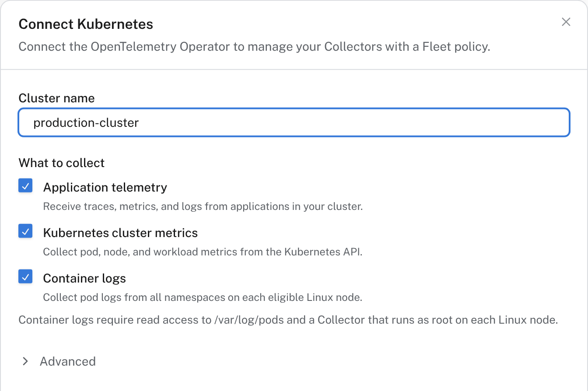

# Manage Collectors

!!! note "Beta"

    Fleet is in beta and can change between releases.

Install an OpenTelemetry Collector on a host with one command, or connect the Collectors in a Kubernetes cluster, then change what they collect and where they send it from Logfire. An OpenTelemetry Collector is a program that gathers telemetry (host metrics, log files, data your applications send it), processes it, and sends it on.

Each Collector runs the pipeline in its **Collector policy**, which you edit in Logfire: see [Change policies](policies.md).

Already run a Collector whose configuration you manage yourself? Add the Collector's own `opamp` extension to see it in Fleet without changing how you configure it: see [Connect an existing Collector](existing-collectors.md).

## Add a host

One command installs a Collector as a service and connects it to Fleet. It works on Linux, macOS and Windows.

1. In **Fleet management**, open **Collectors**, select **Add Collector**, then **Host**.
2. Under **What to collect**, choose a starting point, such as host monitoring for the host's operating system or file logs. Fleet creates a host policy from it, or uses an existing policy you pick. You can change the policy later.
3. Select **Get install command**, then choose the host's operating system.
4. Copy the **enrollment key**. Logfire shows it once. It lets a host join your project, and you can revoke it in your project's Fleet settings.
5. Run the command Logfire shows on the host, and paste the key when it asks. On Linux, for a project in the US region:

    ```bash
    uvx --from 'logfire-cli>=0.1.17' logfire-cli --beta --region us --org <your-org> collector install \
      --project <your-project> --token-stdin --yes
    ```

    `--token-stdin` makes the installer ask for the key without showing it as you type, which keeps it out of your shell history. Use `--region eu` for the EU region. The command needs [uv](https://docs.astral.sh/uv/getting-started/installation/), and the installer asks for administrator access. The host does not need to sign in to Logfire: the enrollment key places it in your project.

6. Keep the setup open. It shows when the host's first data arrives.

To install on many hosts, pipe the key from your secret store into `--token-stdin`, or set `LOGFIRE_COLLECTOR_ENROLLMENT_TOKEN` and leave `--token-stdin` out. Install on each host separately: don't copy one host's Collector state into a machine image, because it holds that host's identity and connection key.

## Connect a Kubernetes cluster

In a cluster, Fleet manages Collectors through the [OpenTelemetry Operator](https://github.com/open-telemetry/opentelemetry-operator), the standard Kubernetes add-on that runs Collectors from `OpenTelemetryCollector` resources. You install one small Operator bridge in the cluster. It connects to Fleet and creates, updates and deletes the Collector resources your policy describes.

1. In **Fleet management**, open **Collectors**, select **Add Collector**, then **Kubernetes**.
2. Name the cluster and choose what to collect: application telemetry sent to the cluster's Collectors, Kubernetes cluster metrics, and container logs.

    

3. Under **Advanced**, set the **Collector namespaces** Fleet may run Collectors in. Turn on **Limit the bridge to this policy's components** to make the bridge refuse a later policy that uses any other receiver, processor or exporter.
4. Select **Get setup instructions**, save the connection key Logfire shows, and follow the steps:
    1. **Prepare your cluster**: check your `kubectl` context and that the Operator is installed. If it isn't, install cert-manager and then the Operator, as the step shows.
    2. **Create the connection Secrets**: the commands prompt for the connection key and for a Logfire write token, which the Collectors use to send data. [Create a write token](../../../how-to-guides/create-write-tokens.md) under **Project settings → Security & access → Write tokens**.
    3. **Grant Collector read access**, if you collect cluster metrics: apply `collector-permissions.yaml`.
    4. **Apply the bridge**: download `fleet-bridge.yaml` and run `kubectl apply -f fleet-bridge.yaml`.

!!! warning "The bridge can change Collectors in any namespace"

    The bridge uses the upstream Operator bridge role. It can read pod and workload status, and create, update or delete `OpenTelemetryCollector` resources in any namespace. The namespaces you choose limit where the policy places Collectors, not what the role can reach. A policy describes the cluster's complete set of managed Collectors: a managed Collector you leave out of it can be deleted. The bridge and its key live in the `logfire-fleet` namespace.

The setup checks the bridge connection, its access to Kubernetes, whether the policy applied, and whether the Collector pods are ready. These checks don't confirm delivery: send some test telemetry and look for it in the [Live view](../live.md).

Don't also run the [Helm-based Kubernetes monitoring setup](../../../how-to-guides/otel-collector/kubernetes-monitoring.md) for the same cluster: both would collect the same data.

## Check your Collectors

The **Collectors** tab lists one row per Collector, named by the host name or pod name it reports. Each row shows:

- **Connection**: whether the Collector is connected to Fleet now.
- **Health**: what the Collector reports about itself.
- **Policy status**: **Applied** when it runs the policy's current version, **Pending** while a new version is on its way, and **Failed** when it refused the version.
- **Policy** and **Environment**.

Select **Needs attention** to show only Collectors that are disconnected, unhealthy or failed to apply their policy. By default the list shows Collectors that reported in the last hour.

Select a Collector to see what it reported: its health per component, the configuration it runs, the components it has, and its warnings and errors from the last hour with a link to the Live view. From there you can restart it, or remove a disconnected Collector's record.

## Troubleshooting

| Symptom | Check |
| --- | --- |
| A host never appears | Run the install command again with `--dry-run` to see each step. The host needs outbound HTTPS to Logfire. |
| A host appears but sends nothing | A Collector collects nothing until it has a policy. Open it and check **Policy status**. |
| **Policy status** shows **Failed** | Open the Collector: Fleet says why. A host Collector checks each version before it runs it, refuses one that uses a component it doesn't include, and keeps running the configuration it has. Fix the policy and publish again. |
| **Failed** says another program holds the port | Another Collector or agent on the host already listens on a port the policy uses, often 4317 or 4318 for OTLP. Stop that program, or change the receiver's port in the policy and publish again. If applications send to that receiver, point their OTLP endpoint at the new port too. A host's first policy has nothing earlier to go back to, so the Collector keeps restarting until then. |
| Kubernetes Collector pods keep restarting after a publish | Kubernetes Collectors don't check a version before running it. Fleet warns when a policy uses components the `otelcol-contrib` image lacks. Publish a fixed version, or restore the previous one (see [roll back](policies.md#see-past-versions-and-roll-back)). |
| The Kubernetes bridge never connects | Check the bridge pod's logs in the `logfire-fleet` namespace, and that the connection key Secret exists there. |
| Kubernetes Collectors don't start | Check that the Operator's controller and webhooks are ready, and that the Collector namespaces exist. |

## Next steps

- [Connect an existing Collector](existing-collectors.md): see a Collector you configure yourself in Fleet.
- [Change policies](policies.md): edit what your Collectors collect and roll out the change.
- [Hosts](../hosts.md) and [Kubernetes](../kubernetes.md): see the metrics your Collectors send.
