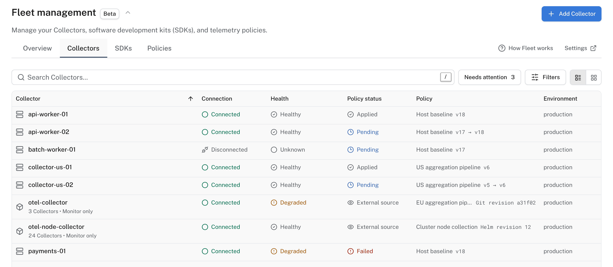

# Fleet

Change what your OpenTelemetry Collectors and applications collect, and where they send it, from Logfire: no config files to edit on each machine and no redeploys.

!!! note "Early access"

    Fleet is in Beta, in early access on Growth, Enterprise, and self-hosted Logfire. To turn it on, enable **Fleet** under [**Settings → Early access**](https://logfire.pydantic.dev/settings/early-access). On self-hosted Logfire, open the same page in your own instance. The choice applies to your account in this browser, not automatically to every member.

Your telemetry reaches Logfire from two kinds of software, and Fleet manages both:

- **Collectors**: an OpenTelemetry Collector is a program that runs on your machines, receives or gathers telemetry (host metrics, log files, data from your applications), processes it, and sends it on. Fleet manages Collectors on hosts (servers, virtual machines, laptops) and in Kubernetes clusters. See [Manage Collectors](collectors.md).
- **Applications**: the SDK inside your application decides what it records and exports. Fleet changes its settings while it runs: sampling, minimum log level, redaction and scrubbing, and which signals to export. See [Manage applications](applications.md).

Each Collector and application takes its settings from a **policy**: a versioned set of settings you edit and publish in Logfire. A Collector policy holds the Collector's whole pipeline. An SDK policy holds the SDK settings it sets, and leaves the rest to the application. A Collector whose configuration is managed elsewhere, such as by Helm or GitOps, shows in Fleet but keeps that configuration. See [Change policies](policies.md).

Clients connect to Fleet over the Open Agent Management Protocol ([OpAMP](https://opentelemetry.io/docs/specs/opamp/)), the OpenTelemetry standard for managing telemetry software remotely. Each client reports its health and the settings it is running, so Fleet also shows what runs where.

## Find Fleet in Logfire

Open **Fleet management** in your project's sidebar. The **Hosts**, **Kubernetes** and **Services** pages also link to it.

The page has four tabs:

- **Overview**: **Flows** draws where your Collectors receive data and where they send it. **Traffic** compares how much each Collector and policy sent with the period before.
- **Collectors**: every Collector on your hosts and in your clusters, with its connection, health, the policy it runs and whether that policy applied. **Add Collector** connects a host or a cluster.
- **SDKs**: every application connected to Fleet. **Add application** connects one.
- **Policies**: every Collector and SDK policy. **Add policy** creates one, and **Rollouts** appears here when you turn rollouts on.

**How Fleet works** opens a short tour of these ideas in the product. **Settings** opens your project's Fleet settings: connection keys and the **Use rollouts** switch.

## When to use Fleet

Use Fleet when you run Collectors or applications on more than a few machines and want to change them from one place: lower a sampling rate during an incident, stop sending debug logs, or add a log file to every host, then see which clients applied the change.

You don't need Fleet to send data to Logfire. An application that calls `logfire.configure()`, or a Collector you configure yourself, sends data without it. Fleet changes only the clients you connect to it.

## Limits

Your plan sets how many applications and Collector policies your organization can manage. Fleet shows your usage and the limit when you reach it.

## Next steps

- [Manage Collectors](collectors.md): install a Collector on a host, or connect a Kubernetes cluster.
- [Manage applications](applications.md): connect a Python, Node.js, Java, .NET or Go application.
- [Change policies](policies.md): edit a policy, publish it, and roll it out.
