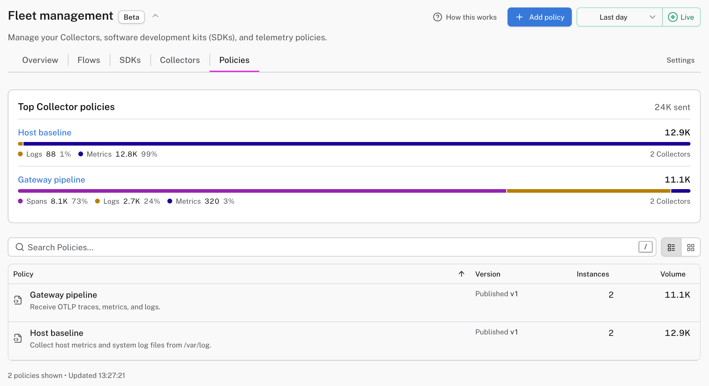
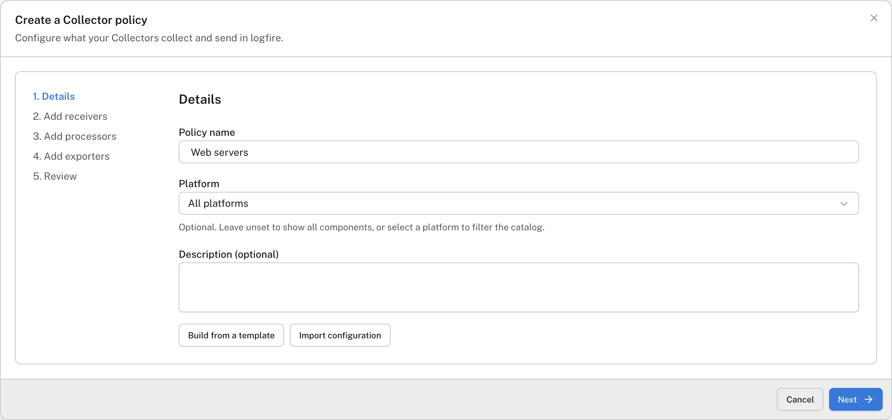
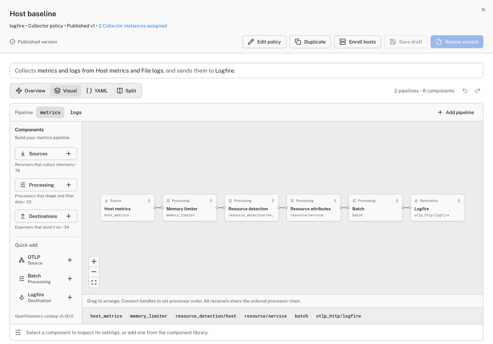
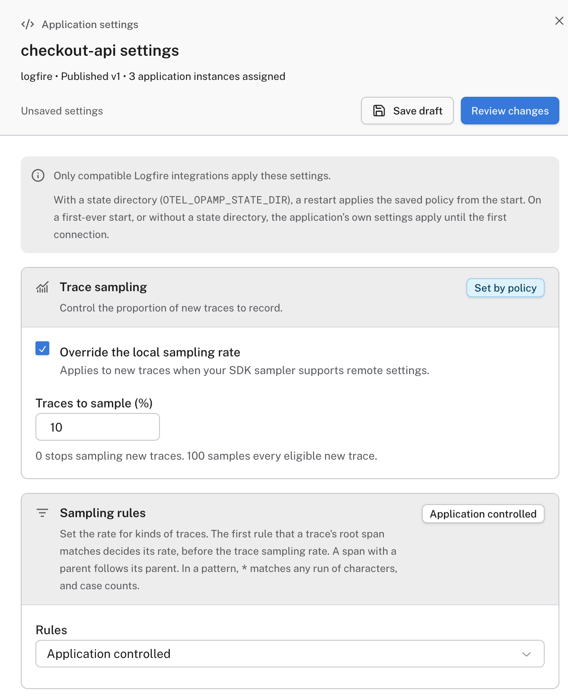
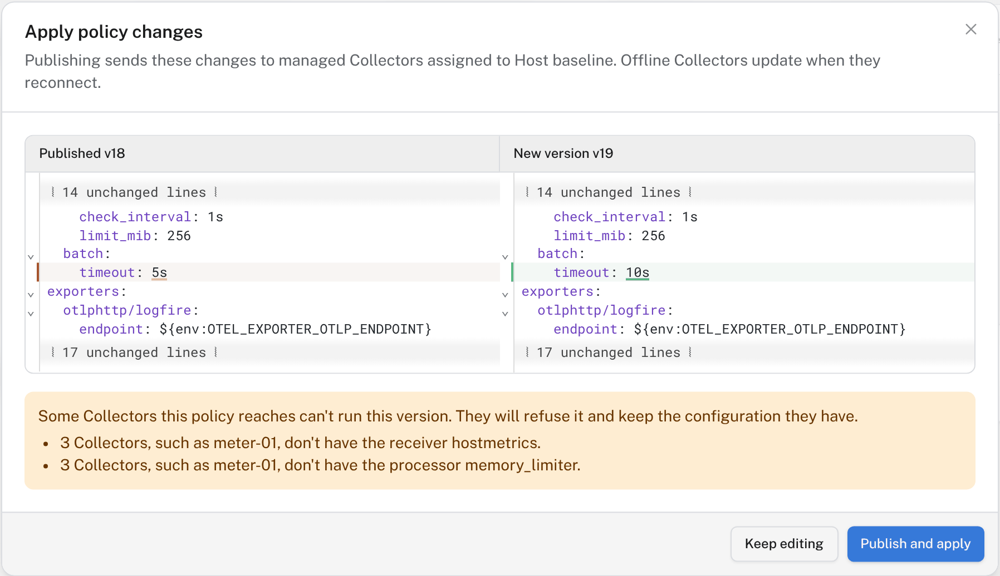
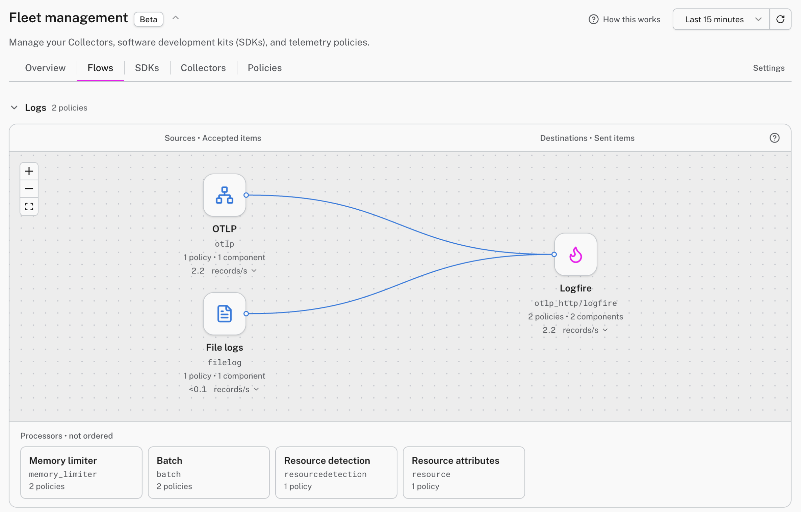

# Change policies

!!! note "Beta"

    Fleet is in beta and can change between releases.

Change what your Collectors and applications collect, review the exact change, then send it to every client that uses the policy. Every published version stays in the policy's history, so you can go back.

A **policy** is a versioned set of settings in Logfire. There are two types:

- A **Collector policy** holds a Collector's whole pipeline: what it receives, how it processes data, and where it sends it. One policy can run on many Collectors. Host and Kubernetes Collectors use separate policies.
- An application's **settings** control its SDK: sampling, exports, log levels, redaction and scrubbing. Each application has its own. A setting left as **Application controlled** keeps the application's own value.

Each Collector runs the policy it was connected with: the one you chose or created when you [added the Collector](collectors.md). The **Policies** tab lists every Collector policy, its published version, and how many Collectors use it.

A Collector you [connect with its own `opamp` extension](existing-collectors.md) shows **Managed outside Fleet** as its policy. Fleet shows its configuration but can't change it.

## Create a policy

1. In **Fleet management**, open **Policies** and select **Add policy**.
2. Choose **Host Collector policy** or **Kubernetes Collector policy**.
3. Enter a **Policy name**. Then select **Build from a template** or **Import configuration**, or add the receivers, processors and exporters yourself, one step at a time. Fleet adds no exporter for you.
4. On **Review**, select **Save draft**, or **Publish policy** to create version 1.

A draft doesn't change any connected client. A published policy doesn't either, until you assign it: choose it under **Use an existing policy** when you [add a host](collectors.md#add-a-host).

## Edit a Collector policy

Open a Collector policy to edit its pipeline. **Overview** shows each signal's pipeline with its live rates. **Visual** shows each pipeline as sources, processing and destinations. **YAML** shows the same Collector configuration as text, and **Split** shows both. Add components from the library on the left, and select one to edit its settings.

The editor checks the configuration's structure and pipeline references. It can't prove that every Collector has every component you use: the review shows which Collectors would refuse a version, and why.

## Edit an application's settings

On the **SDKs** tab, select the application's settings in the **Settings** column, such as **checkout-api settings**. Their sections are **Trace sampling**, **Sampling rules**, **Signal exports**, **Volume controls** (including **Minimum log level**), **Attribute redaction** and **Scrubbing**. Each section shows **Set by policy** or **Application controlled**.

Sampling (recording only a share of new traces) and exports change what reaches Logfire. Redaction and scrubbing (removing sensitive values before data leaves the application) change what Logfire stores.

### Protect data at startup

!!! warning "A new application starts with its own settings"

    With no saved policy, the SDK uses the application's own settings until it connects to Fleet and applies its first policy. Records exported before then are not filtered or scrubbed by the policy. Configure any protection you need from startup in the application itself; don't rely on Fleet for it.

On a restart with a usable saved policy, the SDK restores that policy from its state directory and applies it from startup, before connecting to Fleet. Without a saved policy to restore, the application's own settings apply until the SDK connects and applies its first policy. That happens on a first-ever start, with `OTEL_OPAMP_STATE_DIR=none`, or in a container whose state directory doesn't survive the container being replaced. An unreadable or no-longer-supported saved policy also leaves the application's settings in force. See [SDK startup behavior](https://github.com/pydantic/opamp-clients/blob/main/docs/sdk-settings.md#at-start).

Set `OTEL_OPAMP_STATE_DIR` to a persistent, writable directory so the SDK can keep its last applied policy across restarts, for example `/var/lib/checkout-api/opamp`. Give each process its own directory; in a container, keep it on storage that survives container replacement. If you leave the variable unset, the SDK tries to use a [default state directory](https://github.com/pydantic/opamp-clients/blob/main/docs/default-state-dir.md). Setting `OTEL_OPAMP_STATE_DIR=none` disables persistence, so every start uses the application's settings until a policy arrives.

### Match scrubbing patterns

A policy's scrubbing patterns match a **whole attribute key or whole string value**, ignoring ASCII letter case. They are not regular expressions: only `*` has a special meaning, matching any number of characters, including none.

| Policy pattern | Matches | Does not match |
| --- | --- | --- |
| `zebra` | The key or string value `zebra` | `zebra_ref`, `a zebra reference` |
| `*zebra*` | `zebra`, `zebra_ref`, `a zebra reference` | `horse_ref` |

When a key matches, scrubbing replaces its value. When a string value matches, scrubbing replaces that string. The SDK's [built-in scrubbing patterns](../../../how-to-guides/scrubbing.md) match substrings instead, which is why a built-in pattern such as `password` also catches the key `user_password` without `*`.

A policy **adds** scrubbing patterns. It cannot turn off the SDK's own default scrubbing patterns, such as `auth`, `password` and `secret`. A setting left as **Application controlled** leaves the application's scrubbing in place. See the [policy scrubbing reference](https://github.com/pydantic/opamp-clients/blob/main/docs/sdk-settings.md#scrubbing) for safe keys and other matching rules.

### Apply changes without a restart

Sampling, signal exports, minimum log level, attribute redaction and scrubbing change while the application runs, with no restart or redeploy. After publishing to connected instances, expect changes **within seconds**, not at an exact interval. Sampling changes apply to new traces; export-time settings apply when the next batch is exported. Data already sent cannot be changed by a later policy.

At export, **Minimum log level** drops log records below the chosen level before the policy's rate limiting, redaction and scrubbing. A dropped record never reaches policy scrubbing. For example, with the level set to **Warn**, an info log containing `zebra_ref` is dropped rather than scrubbed. The SDK's own scrubbing may already have run before the policy processes the record.

Records emitted before a policy arrives can still be in an export batch when it takes effect. They receive the export-time settings in force when that batch is processed, not necessarily the settings from when they were emitted.

## Review and publish

1. Select **Save draft** to keep your changes without sending them.
2. Select **Review version** for a Collector policy, or **Review changes** for an application's settings. The review shows the change against the published version.
3. Select **Publish and apply**.

!!! warning "Publishing changes running clients"

    **Publish and apply** sends the new version to every connected client that uses the policy, within seconds. Clients that are offline get it when they reconnect. A version that stops exporting a signal or lowers sampling drops that data from then on: it never reaches Logfire. A version that adds redaction or scrubbing removes those values before the data leaves the client.

A host Collector or an application that can't run a version refuses it and keeps the configuration it has. A host's first policy has nothing earlier to keep, so if it can't run (for example, a port is busy) the Collector keeps restarting until you publish one that works. A Collector's **Policy status** shows **Failed** on the **Collectors** tab, with the reason. For an application, select it on the **SDKs** tab to see how many instances applied the version. Kubernetes Collectors don't check a version first: a version they can't run restarts their pods until you publish a fixed one.

## See past versions and roll back

Each policy lists its newest published versions under **Version history**. Open one to see it as a change against the published version, then select **Restore into editor** to load it as unsaved changes. To roll back, publish that content as a new version.

## See what your Collectors send

The **Flows** tab draws where your published Collector policies receive data and where they send it, with the rate each Collector reported. **Data volume** on the **Overview** tab compares what your Collectors sent with the period before.

Both read the Collectors' own metrics, which Fleet's Collector templates send to Logfire. A Collector policy that doesn't send them shows as **Not reported**.

## Troubleshooting

| Symptom | Check |
| --- | --- |
| No **Add policy** button, or it is disabled | Your role needs permission to manage Fleet, or your organization reached its plan's Collector policy limit. Fleet shows which. |
| Clients still run the old version | Check the client's connection on the **Collectors** or **SDKs** tab. A disconnected client gets the version when it reconnects. |
| **Policy status** shows **Failed** after publishing | Open the client. It names the component or setting it couldn't apply. Fix the policy and publish again. |
| Flows shows **Not reported** | The Collectors in that policy don't send their own metrics to Logfire. |

## Next steps

- [Manage Collectors](collectors.md) and [Manage applications](applications.md): connect more clients.
- [Live view](../live.md): watch the effect of a change as data arrives.
