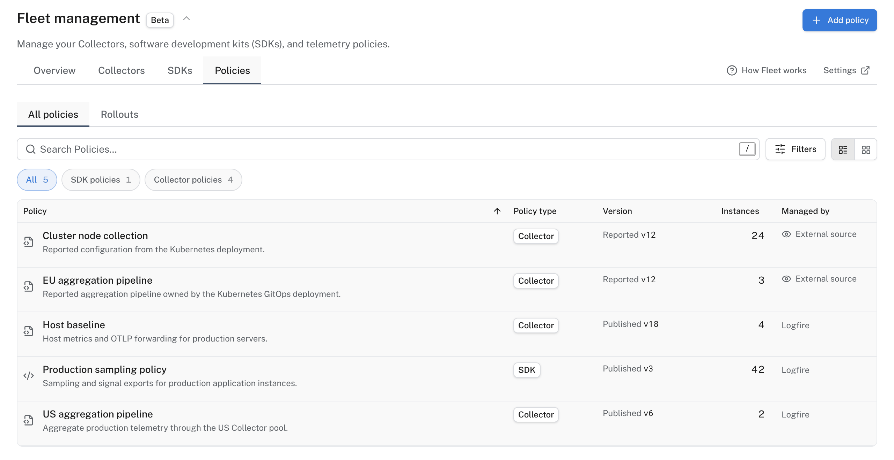
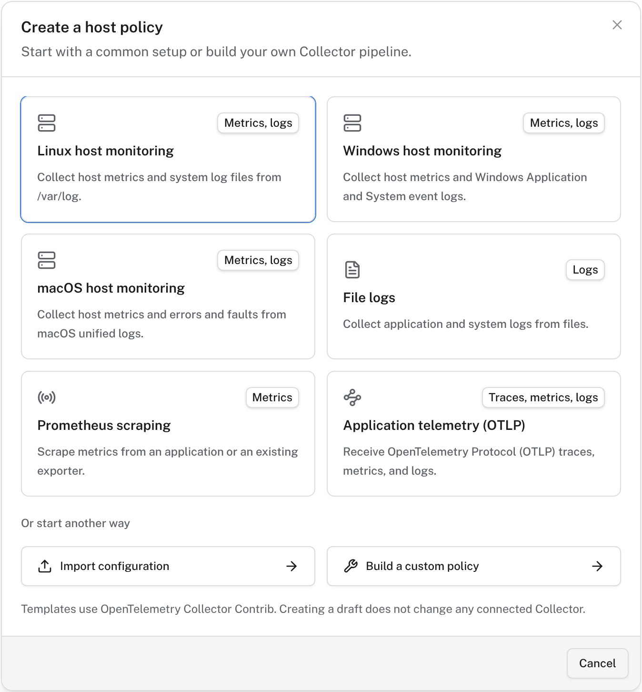
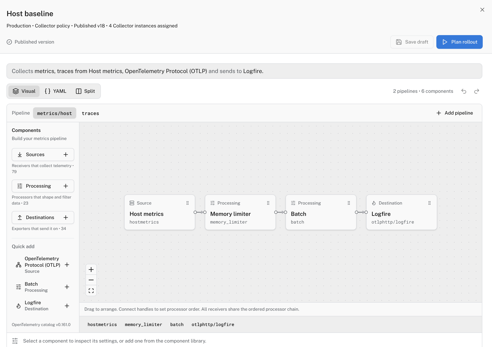
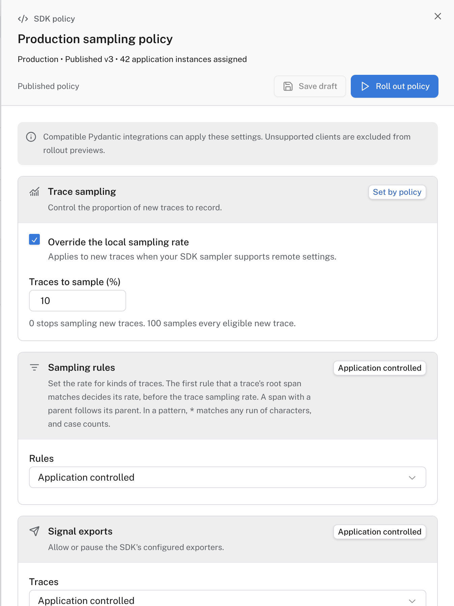
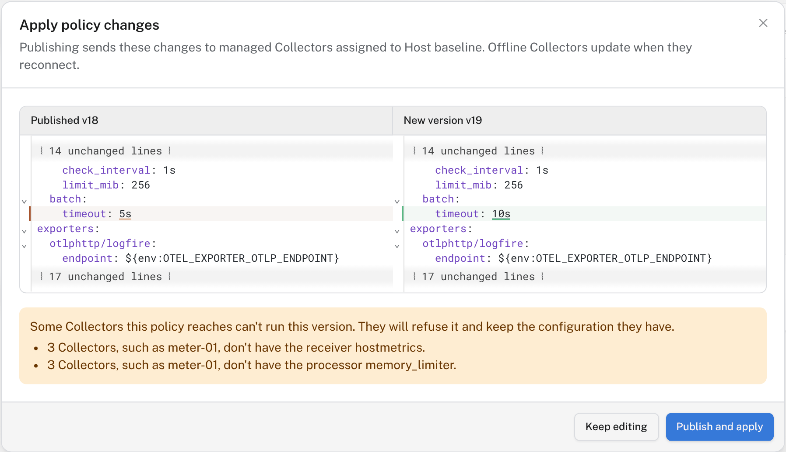
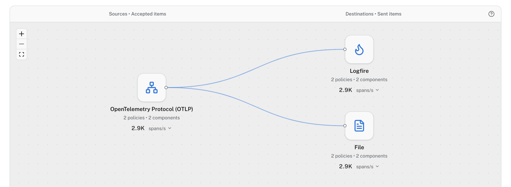

# Change policies

Change what your Collectors and applications collect, review the exact change, then send it to every client that uses the policy, or to a few first. Every published version stays in the policy's history, so you can go back.

A **policy** is a versioned set of settings in Logfire. There are two types:

- A **Collector policy** holds a Collector's whole pipeline: what it receives, how it processes data, and where it sends it. Host and Kubernetes Collectors each use their own Collector policies.
- An **SDK policy** sets chosen SDK settings in your applications: sampling, exports, log levels, redaction and scrubbing. A setting the policy leaves as **Application controlled** keeps the application's own value.

Each client runs the policy it was connected with: the one you chose or created when you [added the Collector](collectors.md) or [connected the application](applications.md). The **Policies** tab lists every policy, its type, its published version, and how many instances use it.

A Collector that reports a configuration managed elsewhere, such as by Helm or GitOps, shows **External source** under **Managed by**. Fleet shows that configuration but doesn't change it.

## Create a policy

1. In **Fleet management**, open **Policies** and select **Add policy**.
2. Choose **Host Collector**, **Kubernetes Collector** or **SDK policy**.
3. Start from a template, import an existing Collector configuration, or build a custom policy.

A new policy is a draft. Creating or saving a draft doesn't change any connected client.

## Edit a Collector policy

Open a Collector policy to edit its pipeline. **Visual** shows each pipeline as sources, processing and destinations. **YAML** shows the same Collector configuration as text, and **Split** shows both. Add components from the library on the left, and select one to edit its settings.

The editor checks the configuration's structure and pipeline references. It can't prove that every Collector has every component you use: the review shows which Collectors would refuse a version, and why.

## Edit an SDK policy

Open an SDK policy to change its sections: **Trace sampling**, **Sampling rules**, **Signal exports**, **Volume controls** (including **Minimum log level**), **Attribute redaction** and **Scrubbing**. Each section shows **Set by policy** or **Application controlled**.

Sampling (recording only a share of new traces) and exports change what reaches Logfire. Redaction and scrubbing (removing sensitive values before data leaves the application) change what Logfire stores.

## Review and publish

1. Select **Save draft** to keep your changes without sending them.
2. Select **Review version** for a Collector policy, or **Review policy** for an SDK policy. The review shows the change against the published version.
3. Select **Publish and apply**.

!!! warning "Publishing changes running clients"

    **Publish and apply** sends the new version to every connected client that uses the policy, within seconds. Clients that are offline get it when they reconnect. A version that stops exporting a signal, lowers sampling or adds redaction drops that data from then on: it never reaches Logfire.

A client that can't run a version refuses it and keeps the configuration it has. Its **Policy status** shows **Failed** on the **Collectors** or **SDKs** tab.

## Roll out to a few clients first

To try a version on a pilot group before every client gets it, turn on **Use rollouts**: select **Settings** in Fleet management, then **Policy delivery**. You can change this setting only when no rollout is running.

With rollouts on, publishing doesn't send the version to anyone:

1. Review the change and select **Publish version** (Collector policy) or **Publish policy** (SDK policy).
2. Select **Plan rollout** or **Roll out policy**, choose how many instances join the pilot, and start it.
3. Watch the pilot under **Policies → Rollouts**. A rollout shows how many instances applied the version and how many failed. **Pause rollout** stops new offers, and **Cancel rollout** stops it.

A pilot doesn't expand on its own. When its results look right, start another rollout with more instances. Clients that aren't in a rollout keep the version they have, and new instances of an application or host start on the policy's stable version.

## See past versions and roll back

Each policy lists its newest published versions. Open one to see it as a change against the published version, then select **Restore into editor** to load it as unsaved changes. To roll back, publish that content as a new version.

## See what your Collectors send

**Overview → Flows** draws where your published Collector policies receive data and where they send it, with the rate each Collector reported. **Overview → Traffic** totals what the Collectors sent per signal and compares it with the period before.

Flows and Traffic read the Collectors' own metrics, which Fleet's Collector templates send to Logfire. A Collector policy that doesn't send them shows as **Not reported**.

## Troubleshooting

| Symptom | Check |
| --- | --- |
| No **Add policy** button, or it is disabled | Your role needs permission to manage Fleet, or your organization reached its plan's Collector policy limit. Fleet shows which. |
| Clients still run the old version | With **Use rollouts** on, publishing reaches no one until you start a rollout. Otherwise, check the client's connection on the **Collectors** or **SDKs** tab. |
| **Policy status** shows **Failed** after publishing | Open the client. It names the component or setting it couldn't apply. Fix the policy and publish again. |
| Flows shows **Not reported** | The Collectors in that policy don't send their own metrics to Logfire. |

## Next steps

- [Manage Collectors](collectors.md) and [Manage applications](applications.md): connect more clients to a policy.
- [Live view](../live.md): watch the effect of a change as data arrives.
