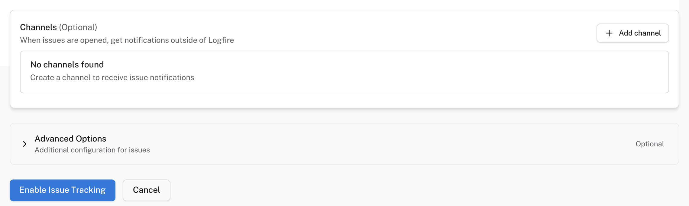
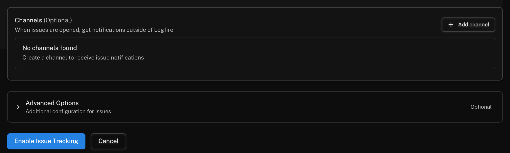
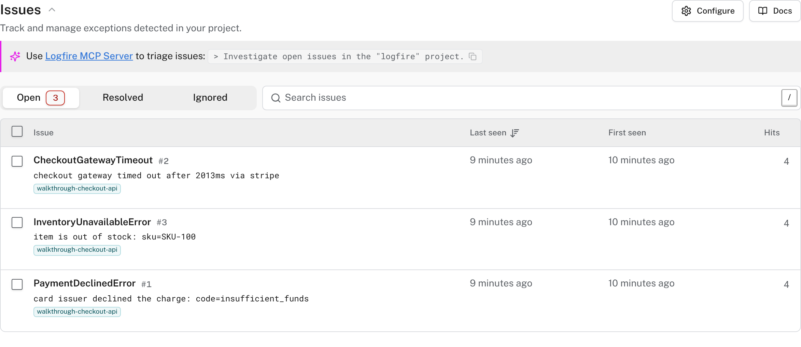
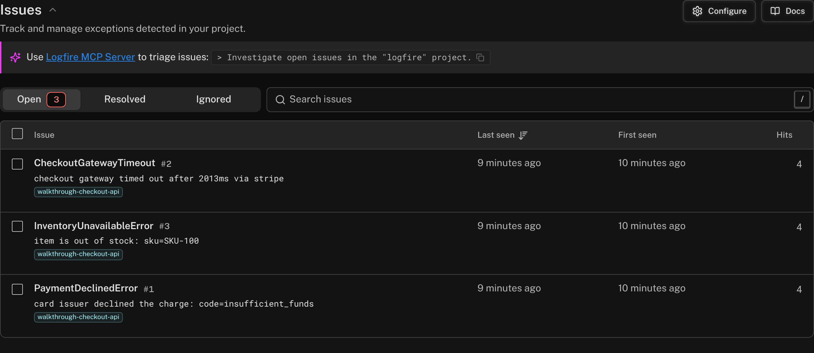
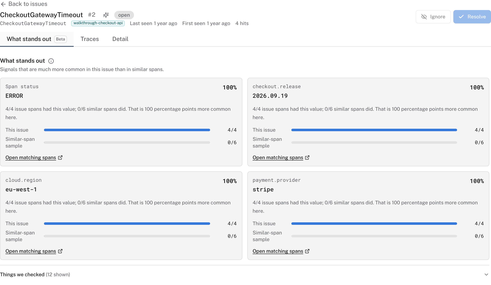
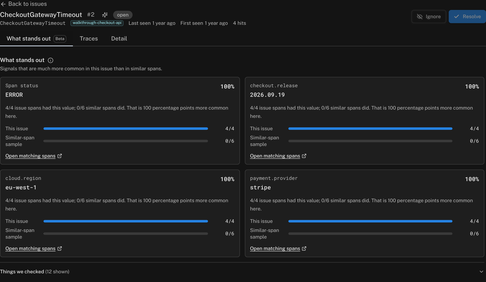

# Error Tracking

Find recurring errors, inspect the requests that failed, and track a fix.

The <OpenInLogfire path="issues" variant="inline" label="Error Tracking" /> page groups repeated exceptions into issues. This feature was previously called **Issues**; some headings and buttons still use that name.

## Enable Error Tracking

You need a project that receives exception data and permission to change its configuration.

1. In the project sidebar, open **Product & Behavior**, then **Error tracking**. In the compact sidebar, select the **Product & Behavior** icon to open its menu.
2. If tracking is disabled, select **Enable Issues**.
3. Select notification channels, or leave them empty to track errors only in Logfire.
4. Select **Enable Issue Tracking**. If you left channels empty, select **Enable anyway** in the **No active channel** dialog.
5. Send new requests that produce exceptions. Tracking runs periodically, so an issue may take a few minutes to appear.

A plain error-level message does not contain the exception data needed to create an issue. For Python examples, see [record exceptions](../onboarding-checklist/add-manual-tracing.md#exceptions).

<!-- ladle-screenshot story="product--error-tracking--issues-form--enable-without-channels" image="../../images/guide/browser-error-tracking-enable" alt="Issue tracking setup with optional notification channels, advanced options, and the Enable Issue Tracking button." viewport="1140x400" scale="2" aspect="2278:684" padding="0" -->

<!-- /ladle-screenshot -->

To change filters or channels later, select **Configure**.

## Find a failure to investigate

Logfire groups exceptions by their fingerprint, an identifier that determines which occurrences belong to the same issue.

The list shows each issue's exception type and message, affected services and environments, and:

- **Hits**: the number of occurrences.
- **Last seen**: the most recent occurrence.
- **First seen**: the first occurrence.

Open an issue to inspect its comparison cards, matching spans, and exception details.

<!-- ladle-screenshot story="product--error-tracking--issues-page--checkout-issues" image="../../images/guide/browser-error-tracking-list" alt="Three open checkout issues, each with four hits, alongside state tabs, search, and configuration controls." viewport="1173x800" scale="2" aspect="2346:1020" padding="0" time="2026-09-19T12:09:30Z" -->

<!-- /ladle-screenshot -->

## Investigate what stands out

Open an issue and select **What stands out** (Beta). The cards compare recent occurrences with similar spans. A span is one operation with a start time and duration.

For example, checkout starts timing out after a release. The timeout issue shows:

| Attribute | Value | This issue | Similar-span sample |
| --- | --- | --- | --- |
| `checkout.release` | `2026.09.19` | 4/4 | 0/6 |
| `cloud.region` | `eu-west-1` | 4/4 | 0/6 |
| `payment.provider` | `stripe` | 4/4 | 0/6 |

All four timeouts share the release, region, and provider. None of the six successful requests in the comparison sample share those values. Start by inspecting Stripe requests in `eu-west-1` on release `2026.09.19`. These values narrow the search; they do not prove what caused the timeouts.

These fields come from [attributes recorded by the sample app](../onboarding-checklist/add-manual-tracing.md#attributes). Record context such as the release or provider on your app's spans so Logfire can compare those values. The cards can also show status or duration signals.

1. Select **Open matching spans** on a card to inspect the records behind it.
2. Expand **Things we checked** to see values that did not stand out and why.
3. Select **Traces** to inspect individual occurrences and their surrounding trace.
4. Select **Detail** for the first recorded exception message and traceback.

<!-- ladle-screenshot story="product--error-tracking--issue-detail--checkout-timeout-standouts" image="../../images/guide/browser-error-tracking-standouts" alt="What stands out for CheckoutGatewayTimeout: error status, release, region, and provider each appear in four of four issue spans and zero of six similar spans." viewport="1173x900" scale="2" aspect="2346:1364" padding="0" time="2026-09-19T12:09:30Z" -->

<!-- /ladle-screenshot -->

The comparison sample contains completed spans from the same service and operation, excluding this issue's occurrences. It can include other failures.

The analysis uses limited samples of recent data, so card counts can differ from total **Hits**. If no comparable spans are available, the cards show shared values without a comparison.

## Track issue states

| State | Meaning | What happens on another occurrence |
| --- | --- | --- |
| **Open** | Needs attention. | The issue stays open and its hit count increases. |
| **Resolved** | Marked as fixed. | The issue reopens. |
| **Ignored** | A failure your team has decided not to act on. | The issue stays ignored. |

Resolve an issue after you deploy a fix. Ignore an issue only when your team has decided the failure needs no follow-up.

## Manage issues

Open an issue to **Resolve**, **Ignore**, or **Re-open** it. A state change returns you to the list. Select **Resolved** or **Ignored** to find an issue you moved out of **Open**.

For several issues, select their checkboxes and use the action bar. **Re-open** is available in the **Resolved** and **Ignored** tabs.

You can **Delete** resolved issues. Deletion is permanent. If the exception occurs again, Logfire creates a new issue.

## Receive issue notifications

Select **Configure**, choose one or more existing notification channels, and select **Save changes**. Notifications are sent when new issues open or resolved issues reopen. Ignored issues do not send notifications.

To create a channel:

1. In **Configure**, select **Add channel**.
2. Enter a **Channel Name** and choose a **Type**.
3. Fill in the destination fields. For **Webhook**, enter the **Webhook URL**.
4. If the type requires a connectivity test, select **Send test message**. This sends a notification to that destination.
5. Select **Create channel**, then select the channel in the issue configuration and select **Save changes**.

## Investigate with an AI assistant

Connect your coding assistant to the [Logfire Model Context Protocol (MCP) server](../../how-to-guides/mcp-server.md). Copy the prompt from the banner above the issue list into your assistant to start an investigation.

## Sort and search

Use **Search issues** to search exception messages.

On a wide screen, select **Issue**, **Last seen**, **First seen**, or **Hits** in the list header to sort. Select the same heading again to reverse the order. On narrow screens, use the sort control above the list.

## Disable Error Tracking

!!! warning "Permanent data loss"
    Disabling tracking permanently deletes the project's issues, states, and history. Re-enabling it starts a new issue history.

1. Open **Error tracking** and select **Configure**.
2. Select **Disable issues**.
3. In the dialog, type the project name exactly as shown.
4. Select **Disable issues** to confirm.

## Verify

After enabling tracking, send repeated requests that raise the same exception from the same code path. You should see one issue in **Open** with multiple hits. Open it to inspect **What stands out**, **Traces**, and **Detail**.

To check recurrence in a test project, resolve an issue and find it in **Resolved**. Produce the same exception again. Once tracking processes it, the issue should return to **Open** with more hits. An ignored issue should stay in **Ignored** after further occurrences.

## Troubleshooting

- **No issues appear:** check that tracking is enabled, new exception records reach this project, and the configured filter includes them. Allow a few minutes for processing.
- **No standout patterns appear:** values may vary across occurrences or also be common in similar spans. Inspect **Things we checked** and individual traces.
- **No comparison appears:** send representative traffic, including successful requests, from the same service and operation.
- **Configure is missing:** ask a project administrator to change the configuration or grant the required permissions.
