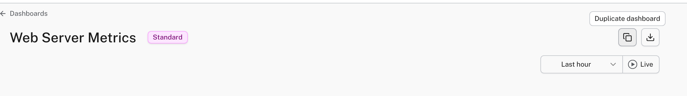

# Standard dashboards

Standard dashboards are [dashboards](dashboards.md) built and maintained by the Logfire team. Turn one on and it works with the data your project already sends, and it picks up improvements without any work from you. You can't edit a standard dashboard, but you can duplicate it into a custom dashboard that you can change.

## Turn on a standard dashboard

1. Open <OpenInLogfire path="dashboards" variant="inline" label="Dashboards" /> for your project.
2. Click **New Dashboard**.
3. Browse the dashboards under the **Agents**, **Infrastructure**, and **Logfire** tabs.
4. Click **Enable dashboard**. Logfire adds the dashboard to your project and opens it.

A dashboard you turned on shows **Open** and **Disable** buttons in the same list.

Dashboards for infrastructure services such as Redis, PostgreSQL, and Kafka come with their [integration](integrations.md), together with alerts. To install one, select **Integrations** under **Infrastructure** in your project's sidebar, choose the service, and click **Install**.

## Customize a standard dashboard

A standard dashboard shows a **Standard** badge next to its title. To get a copy you can edit:

1. Open the standard dashboard and click **Duplicate dashboard** (the copy icon) in the top right.
2. Enter a name for the copy. It defaults to "Copy of" followed by the original name.
3. Confirm. Logfire creates a custom dashboard with the same panels, variables, and layout, and opens it.

The copy is a snapshot. It doesn't receive the updates the Logfire team makes to the original standard dashboard. See [Build a custom dashboard](dashboards.md#build-a-custom-dashboard) to change it.

## Available dashboards

### Usage Overview

This dashboard is recommended for all users to [manage their costs](../../logfire-costs.md#standard-usage-dashboard). It breaks down your data by [environment](../../reference/sql.md#deployment_environment), [service](../../reference/sql.md#service_name), [scope](../../reference/sql.md#otel_scope_name) (the instrumentation that produced the data), and [`span_name`](../../reference/sql.md#span_name) or `metric_name` for `records` and `metrics` respectively. This lets you see which services and operations generate the most data. The **Group by environment**, **Group by service**, and **Group by scope** selectors control which of those columns the breakdown uses.

### Exceptions

This dashboard is recommended for all users, especially for monitoring Python applications. It shows the most common exceptions grouped by [service](../../reference/sql.md#service_name), [scope](../../reference/sql.md#otel_scope_name), [`span_name`](../../reference/sql.md#span_name), and [`exception_type`](../../reference/sql.md#exception_type). You can also filter by any of these four columns with the selectors at the top.

Each row also shows the most common [`message`](../../reference/sql.md#message) and [`exception_message`](../../reference/sql.md#exception_message) values. These vary more (higher cardinality), which is why they don't each produce a new row. If there are several different values, each one is shown on its own line with a count in brackets at the start. Hover over a cell to read all of it. Note that `message` is often the same as `span_name`.

Exceptions are usually errors, but not always. Some exceptions are special-cased and set the [`level`](../../reference/sql.md#level) to `warn`. By default, the dashboard is filtered to `level >= 'error'`. Set the **Errors only** selector to `No` to see all exceptions.

Scroll all the way to the right to see the **SQL filter to copy to Live View** column, which you can use to investigate the details of any group.

### Web Server Metrics

This dashboard shows how long each of your web server endpoints takes to respond to requests, and how often they succeed and fail. It relies on the standard OpenTelemetry `http.server.duration` or `http.server.request.duration` metric, which many instrumentation libraries collect, including those for FastAPI, Flask, Django, ASGI, and WSGI.

The panels break down requests by route, service, and endpoint:

- **Total duration:** endpoints that need to be optimized or called less often.
- **Average duration** and **P95 duration:** endpoints that are slow for a typical request, or for the slowest 5% of requests.
- **2xx, 4xx, and 5xx request counts:** successful requests, bad requests, and server errors.
- **4xx and 5xx error rates:** the share of requests that fail.

The panels over time show the five busiest endpoints in each interval. Hover over a time series to see the most impactful endpoint at the top of the tooltip.

!!! note
    Metrics sent through an OpenTelemetry Collector (a separate program that gathers and forwards telemetry) or another OpenTelemetry Protocol (OTLP) exporter must use delta temporality. Delta values report only the change during each collection interval. If the metrics reach Logfire as cumulative values, you can still query them in Explore, but the dashboard stays empty. When an OpenTelemetry SDK creates the metrics, set `OTEL_EXPORTER_OTLP_METRICS_TEMPORALITY_PREFERENCE=delta` in the application process. This configures the SDK before it sends metrics either directly to Logfire or through a Collector; do not set it on the Collector process. If you cannot configure the source, use the Collector's [cumulative-to-delta processor](https://github.com/open-telemetry/opentelemetry-collector-contrib/tree/main/processor/cumulativetodeltaprocessor).

### Basic System Metrics

This dashboard shows essential system resource usage. It comes in two variants:

- **Basic System Metrics (Logfire):** uses the data exported by [`logfire.instrument_system_metrics()`](../../integrations/system-metrics.md).
- **Basic System Metrics (OpenTelemetry):** uses data exported by any OpenTelemetry-based instrumentation that follows the standard semantic conventions.

Both variants show:

- **Process count:** the number of running processes on the system.
- **System CPU usage %:** the share of total processing power used by the whole system, averaged across all CPU cores.
- **Process CPU usage %:** CPU used by a single process. A process that uses 2 CPU cores to full capacity shows 200%.
- **Memory usage %:** the share of memory in use by the system.
- **Swap usage %:** the share of swap space in use by the system. It stays empty if no services have swap.

### LLM Tokens and Costs

This dashboard breaks down input and output LLM token usage by model. It comes in two variants with the same charts but different data sources:

- **LLM Tokens and Costs (from records):** uses the `records` table, specifically span [attributes](../../reference/sql.md#attributes) that follow OpenTelemetry conventions. This variant works with more instrumentations, as some don't emit metrics. It's also easier to [duplicate and customize](#customize-a-standard-dashboard) if you want to filter by other attributes.
- **LLM Tokens and Costs (from metrics):** uses the `metrics` table, specifically the [`gen_ai.client.token.usage`](https://opentelemetry.io/docs/specs/semconv/gen-ai/gen-ai-metrics/#metric-gen_aiclienttokenusage) metric. This variant loads data over long time ranges faster. It's also more accurate if your spans are [sampled](../../how-to-guides/sampling.md).

If you only use the [Pydantic AI](../../integrations/llms/pydanticai.md) instrumentation, use the `metrics` variant. Otherwise, turn on both variants and compare them. If they look roughly the same (small differences are expected), disable the `records` variant to improve performance.

Each variant has three panel groups:

- **Token usage:** input and output tokens by model and by type, over time and in total.
- **Time to first token (streaming):** how long streamed responses take to start, as the median and the 95th percentile, over time and by model.
- **Costs (Pydantic AI only):** cost by model, over time and in total. The [Pydantic AI](../../integrations/llms/pydanticai.md) instrumentation records costs in the `operation.cost` span attribute (since [v1.0.0](https://github.com/pydantic/pydantic-ai/releases/tag/v1.0.0)) and the `operation.cost` metric (since [v1.0.11](https://github.com/pydantic/pydantic-ai/releases/tag/v1.0.11)).

### AI Gateway Provider Health

If you use the [AI Gateway](../../reference/advanced/gateway/index.md), this dashboard shows the 95th percentile latency, error rate, and rate limits for each provider. It reads the spans that the gateway exports to your project.
