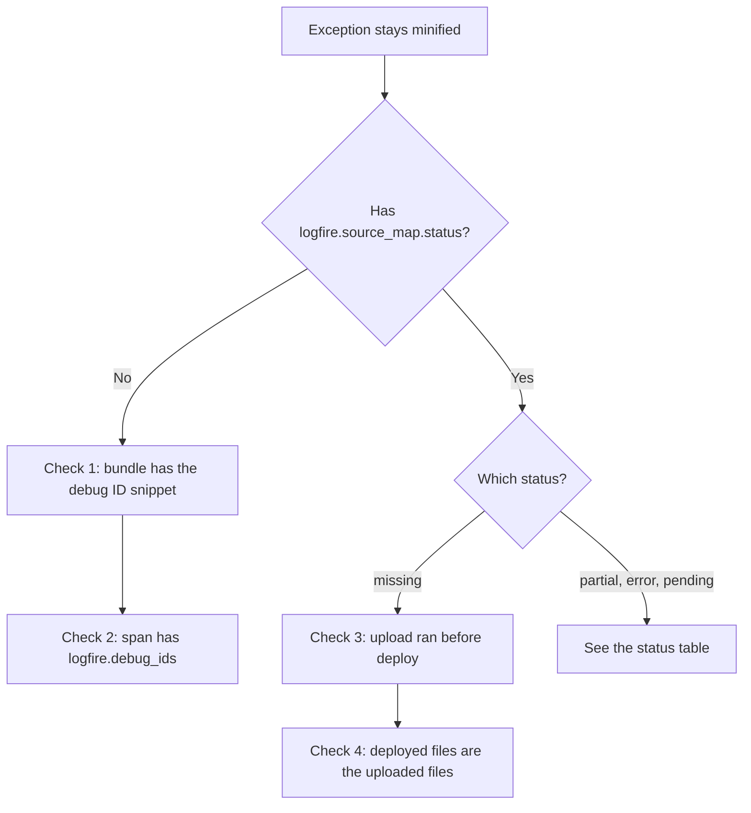

# Browser source maps

!!! warning "Experimental"
    Browser source maps are experimental. The behavior on this page can change before the feature reaches Beta.

Upload your source maps from CI, and Logfire shows browser exceptions with your original file, function and line instead of minified code.

Production JavaScript is usually *minified*: the bundler (the build tool that combines your code into a few files, such as Vite, webpack or Turbopack) renames functions and puts the code on a few long lines. A stack trace from a minified bundle points at `index-a1b2.js:1:48213`, which tells you little. A *source map* is a JSON file that the bundler writes next to each bundle. It maps every position in the minified file back to the original file, line and function.

Logfire matches each stack frame to its map by a *debug ID*: a unique ID that the build writes into both the bundle and its map. See [How it works](#how-it-works) for the details.

## Before you begin

You need:

- An app that sends browser exceptions to Logfire with `@pydantic/logfire-browser` version 0.34.0 or later. See the [browser SDK setup](https://pydantic.dev/docs/logfire/instrument/typescript/packages/browser/).
- The ID of your *frontend application*. A frontend application is the entry in a Logfire project that gives the browser data of one web app a stable name and a restricted token. Find it under **Project settings → Frontend applications** (see [Frontend](../guides/web-ui/frontend.md)). The examples on this page read it from the `FRONTEND_APPLICATION_ID` environment variable.
- The **Browser source maps** feature turned on. Open **Settings → Early access**, select the flask icon next to the **Early access** heading to show experimental features, and turn on **Browser source maps**. The API key form shows the **Source maps** scope only after this step.
- A project API key with the `project:write_sourcemaps` scope (**Source maps** on the API key form), in the `LOGFIRE_API_KEY` environment variable. Create it on the project's API keys page in Logfire. The project comes from the key, so you do not pass it on the command line.
- The Logfire CLI for JavaScript projects, the `logfire-cli` npm package, version 0.1.22 or later. Run it with `npx logfire-cli`. The `logfire` command that the Python package installs has no `sourcemap` command.

The commands on this page use two global flags:

- `--beta`, on every command: the CLI runs the `sourcemap` commands only with this flag, or with `LOGFIRE_CLI_BETA=true`. The commands can change.
- `--region us` or `--region eu`, on `upload` only: the Logfire instance that the API key belongs to. For a self-hosted Logfire, pass `--base-url` with the URL of your instance.

## Set up source maps

Every setup has the same three steps, run in CI before the deploy:

1. Build with source maps and debug IDs.
2. Upload the maps.
3. Deploy the exact files that you built.

### Build with source maps and debug IDs

For Next.js, set this in `next.config.js`:

```js title="next.config.js"
module.exports = {
  productionBrowserSourceMaps: true,
  turbopack: {
    debugIds: true, // Next.js 16.0.0 or later
  },
}
```

| Build | Debug IDs come from | Run `inject` |
| --- | --- | --- |
| Next.js 16.0.0 or later with Turbopack | `turbopack.debugIds: true` | No |
| Next.js with webpack (`next build --webpack`), or before 16.0.0 | `inject` | Yes, on `.next` |
| Vite, webpack, esbuild, Rollup and other bundlers | `inject` | Yes, on the build output directory |

For other bundlers, turn on source maps:

| Bundler | Setting |
| --- | --- |
| Vite | `build.sourcemap: true` in `vite.config.js` |
| webpack | `devtool: 'source-map'` in `webpack.config.js` |
| esbuild | `--sourcemap` |
| Rollup | `output.sourcemap: true` in `rollup.config.js` |

Then run `inject` on the build output directory. It gives each bundle and its map the same debug ID:

```bash
npx logfire-cli --beta sourcemap inject dist
```

### If you also use another error tool

Use the Logfire CLI to prepare the build for Logfire, also when the project uses another error tracking tool. Run `logfire sourcemap inject` as the last inject step, after the inject step of any other tool, such as `sentry-cli sourcemaps inject`, `datadog-ci sourcemaps inject` or `posthog-cli sourcemap inject`. Then upload the maps to Logfire with the Logfire CLI:

```bash
# Run the inject steps of other tools first.
npx logfire-cli --beta sourcemap inject dist
npx logfire-cli --beta --region us sourcemap upload dist \
  --frontend-application-id "$FRONTEND_APPLICATION_ID" --delete
```

Run `inject` before any step that hashes or compresses the bundle, such as precompression (`.br`, `.gz`), subresource integrity hashes or content-addressed CDN uploads. `inject` changes the bundle bytes, so a hash computed before it no longer matches. Running `inject` again on the same directory is safe.

!!! note "Browser exceptions only"
    This page covers exceptions that `@pydantic/logfire-browser` records in the browser. Next.js middleware and edge runtime code run on the server, so the browser SDK does not send their exceptions.

### Upload the maps

!!! warning "Upload before you deploy"
    Logfire resolves an exception only if its source map is already stored when the exception arrives. An exception that arrives first stays minified, and a later upload does not change it.

```bash
npx logfire-cli --beta --region us sourcemap upload dist \
  --frontend-application-id "$FRONTEND_APPLICATION_ID" \
  --delete
```

`--delete` removes the `.map` files after the upload, so the deploy does not serve your source maps to browsers. Leave it out only if you want the maps to be public.

For Next.js, upload `.next/static`, because that directory holds the browser chunks. `inject` runs on all of `.next`, but only `.next/static` is served to browsers, from `/_next/static`:

```bash
npx logfire-cli --beta --region us sourcemap upload .next/static \
  --frontend-application-id "$FRONTEND_APPLICATION_ID" \
  --base-url-path /_next/static \
  --delete
```

`upload` first asks Logfire which builds it already stores, then uploads only the missing ones, in batches. So a run for an unchanged build sends one request. If a file fails, `upload` exits with a non-zero code, so the CI job fails before the deploy. See [Upload results](#upload-results).

!!! warning "Your source code is in the maps"
    Most bundlers embed your original source code in each map, in the `sourcesContent` field. By default, `upload` sends it to Logfire, and Logfire stores it with the map. Pass `--strip-sources` to send the maps without the source text. Frames still resolve to the original file, line and column.

    Logfire has no page and no API that returns an uploaded map or its source text. Everyone who can read the project's data sees the resolved stack traces, which contain your original file and function names. You cannot delete an uploaded map yourself. Logfire deletes it at the end of its [retention](#retention).
    <!-- TODO: confirm whether Logfire shows source lines from `sourcesContent`. The ingest step does not use the source text today. -->

### Deploy the files you built

Deploy the same build output that you uploaded: the same generated code and the same debug IDs. If the deploy builds the code again, or a later step rewrites a bundle, its stack traces no longer match the uploaded map. The `sourceMappingURL` comment that `--delete` removes is an exception, because removing it changes no code position.

### Run it in CI

In GitHub Actions, store the key as a repository secret:

```yaml
- run: npm ci && npm run build
- run: npx logfire-cli --beta sourcemap inject dist
- run: >-
    npx logfire-cli --beta --region us sourcemap upload dist
    --frontend-application-id "$FRONTEND_APPLICATION_ID" --delete
  env:
    LOGFIRE_API_KEY: ${{ secrets.LOGFIRE_API_KEY }}
```

In GitLab CI, store the key as a masked CI/CD variable named `LOGFIRE_API_KEY`. `LOGFIRE_RELEASE` names the build. In GitHub Actions and on Vercel, the CLI reads the commit SHA from the environment, so you do not set it there.

```yaml
build:
  variables:
    LOGFIRE_RELEASE: $CI_COMMIT_SHA
  script:
    - npm ci && npm run build
    - npx logfire-cli --beta sourcemap inject dist
    - >-
      npx logfire-cli --beta --region us sourcemap upload dist
      --frontend-application-id "$FRONTEND_APPLICATION_ID" --delete
```

On Vercel, the build and the deploy are one step. Set `LOGFIRE_API_KEY` as a build environment variable, and add the upload to the build command after `next build`:

```bash
next build && \
  npx logfire-cli --beta --region us sourcemap upload .next/static \
    --frontend-application-id "$FRONTEND_APPLICATION_ID" \
    --base-url-path /_next/static --delete
```

With webpack, or on Next.js before 16.0.0, add `npx logfire-cli --beta sourcemap inject .next &&` after `next build &&`.

## Check the result

A resolved exception shows the original file, line and column in its stack trace, in the `exception.stacktrace` attribute. The original function names appear when the bundler's map lists them in its `names` field. If the map has no `names`, the frames keep the minified function names:

```text
Error: checkout failed
    at submitOrder (src/checkout.ts:42:5)
    at HTMLButtonElement.<anonymous> (src/checkout.ts:88:3)
```

The `logfire.source_map.original_stacktrace` attribute on the same exception holds the minified stack trace as the browser sent it:

```text
Error: checkout failed
    at o (https://app.example.com/assets/index-a1b2.js:1:48213)
    at HTMLButtonElement.<anonymous> (https://app.example.com/assets/index-a1b2.js:1:48392)
```

Logfire writes the `logfire.source_map.status` attribute on each exception that carries debug IDs. `ok` means every frame resolved. Any other value means that at least one frame stayed minified (see [Troubleshooting](#troubleshooting)). To find those exceptions:

```sql
SELECT start_timestamp, exception_type, attributes->>'logfire.source_map.status' AS status
FROM records
WHERE attributes->>'logfire.source_map.status' != 'ok'
ORDER BY start_timestamp DESC
```

### Get alerted when exceptions stay minified

Logfire has a recommended alert, **Unresolved browser source maps**. It is not on by default. To turn it on:

1. In your project, open **Alerts** and create a new alert.
2. Pick **Unresolved browser source maps** from the recommended templates.
3. Choose where to send the notification, then save. You can edit the query before you save.

The alert checks every 10 minutes. It fires when at least one exception from the last 10 minutes has the status `missing`, `error` or `pending`. It ignores `partial`.

## Troubleshooting

Start from the status on the exception:



### Status table

| Status | Meaning | Likely cause | Fix |
| --- | --- | --- | --- |
| `partial` | Some frames resolved. The others stay minified. | The upload covered only a part of the build output, or one file failed. | Read the upload log for skipped and failed files. Upload the full build output directory. |
| `missing` | No frame resolved. Logfire has no map for the debug IDs. | The upload did not run for this build, or it ran after the exception arrived, or the deployed files are not the uploaded files. | Do checks 3 and 4. |
| `error` | No frame resolved. Logfire could not load or use the map. | The bundler wrote a map that does not follow the source map format. | Check that the `.map` file from the build is valid. Fix the build, then build, `inject` and upload again. If the map is valid, contact support. |
| `pending` | No frame resolved. Logfire did not load the map in time. | The first exceptions of a new build, or many new builds at once. | Uploading again does not help. These exceptions stay minified for good, and Logfire tries again on the next exception for the same build. If new exceptions keep `pending`, contact support. |

For `missing`, `error` and `pending`, the stack trace stays as the browser sent it.

### No status: the exception carries no debug IDs

**Check 1: the built bundle contains the debug ID snippet.** For a `dist` directory:

```bash
grep -rlE '_debugIds|_logfireDebugIds' dist --include='*.js' --include='*.mjs' --include='*.cjs'
```

For a Next.js app:

```bash
grep -rlE '_debugIds|_logfireDebugIds' .next/static --include='*.js'
```

The command lists each bundle that registers a debug ID. If a bundle is not in the list, turn on `turbopack.debugIds` or run `inject` (see [Build with source maps and debug IDs](#build-with-source-maps-and-debug-ids)). Then do the same check on the file that the browser downloads, to make sure that the deploy serves the new build.

**Check 2: the exception span has `logfire.debug_ids`.**

```sql
SELECT start_timestamp, exception_type, attributes->>'logfire.debug_ids' AS debug_ids
FROM records
WHERE is_exception
ORDER BY start_timestamp DESC
```

If the bundle has the snippet but the attribute is empty, check these causes:

- The app uses `@pydantic/logfire-browser` earlier than 0.34.0. Upgrade the SDK.
- No frame in the stack trace comes from a bundle with a debug ID. For example, the error comes from a third-party script.

### Status `missing`

**Check 3: the upload ran before the deploy.** Compare the time of the upload step in the CI log with the time of the deploy. The upload must finish first, and it must exit with code 0.

**Check 4: the deployed files are exactly the uploaded files.** Compare the `//# debugId=` comment at the end of the deployed bundle with the comment in the bundle that CI uploaded:

```bash
curl -s https://app.example.com/assets/index-a1b2.js | tail -c 200
tail -c 200 dist/assets/index-a1b2.js
```

If the IDs differ, the deploy built the code again. Deploy the output of the build that you uploaded. If the IDs are the same but frames resolve to the wrong lines, a step after the upload changed the bundle. Do not minify the files again or compress them again with a tool that rewrites the JavaScript after `inject`. Transport compression by the web server or the CDN (`gzip`, Brotli) is safe, because the browser gets the same bytes back.

## Several apps and environments

Logfire stores a map in the project that the API key belongs to. `inject` derives the debug ID from the bundle's bytes, so the same build output always has the same debug ID.

| Setup | What to do |
| --- | --- |
| Staging and production deploy the same build output and send to one project. | Upload one time. The map resolves exceptions from both environments. |
| Staging and production send to different projects. | Run `upload` one time for each project, with the API key of that project. Pass `--delete` only on the last run, because it removes the `.map` files. |
| Each environment has its own build. | Run `inject` and `upload` for each build. |
| A monorepo (one repository with several apps) | Run `inject` and `upload` for each app, on the build output directory of that app, with the `--frontend-application-id` of that app. |

## How it works

```
build (CI)                         browser                         Logfire
──────────                         ───────                         ───────
bundle + map share a debug ID ───► bundle registers its debug ID
sourcemap upload ─────────────────────────────────────────────────► stores the map
                                   exception: the SDK adds the
                                   debug IDs of the frames ───────► resolves the frames at ingest
```

1. A snippet at the top of each bundle registers the bundle's debug ID when the bundle loads. `inject` writes the ID to `globalThis._logfireDebugIds`. Turbopack and other tools write it to `globalThis._debugIds`, which is a shared convention. The SDK reads both registries.
2. When the Logfire browser SDK records an exception, it looks up the files in the stack trace in that registry. It adds the matches to the exception span as the `logfire.debug_ids` attribute: a JSON map from file URL to debug ID.
3. When the span reaches Logfire, Logfire finds the uploaded source map for each debug ID and rewrites the stack trace to the original source. This happens once, at ingest (when Logfire receives and stores the data). Logfire does not process a stored exception again, which is why the upload must come before the deploy.

## Reference

### Options

These are the flags that this page uses:

| Option | Purpose |
| --- | --- |
| `<DIRECTORY>` | The build output directory to upload. |
| `--frontend-application-id <UUID>` | The browser application that owns the bundles. |
| `--base-url-path <PATH>` | The URL path that the directory is served from. The default is `/`. Logfire records it with the map, but matches by debug ID only. |
| `--strip-sources` | Remove the embedded source text (`sourcesContent`) from the uploaded maps. |
| `--delete` | Delete each `.map` file and the bundle's `sourceMappingURL` comment after the upload succeeds. |
| `--region <REGION>`, `--base-url <URL>` | The Logfire instance that the API key belongs to: `us`, `eu`, or the URL of a self-hosted instance. |

<!-- TODO: link to the public `logfire-cli` reference page for `sourcemap` when it is published. -->
For the other flags, run `npx logfire-cli --beta sourcemap upload --help`.

### Upload results

The CLI prints one line per bundle with its debug ID and the result, then a summary. A result other than stored, already uploaded or skipped shows as `failed`, with the reason from the server.

| Result | Meaning | What to do |
| --- | --- | --- |
| Stored (`created`) | Logfire stored the file. | Nothing. |
| Already uploaded (`exists`) | Logfire already stores a map for this debug ID. Logfire keeps the first upload of each debug ID. | Nothing. A retry of the same upload is safe. |
| Skipped | Another file in the same run has the same debug ID, for example the same bundle copied to two folders. The CLI uploads the first copy only. With `--delete`, it also deletes the local `.map` files of the other copies. | Nothing. |
| Invalid | Logfire rejected the map. For example, it is not valid JSON, or its `debugId` does not match the debug ID of its bundle. | Check the build output, then run `inject` and `upload` again. |
| Too large | The map or the bundle is larger than 60 MiB, measured before compression. | Split the bundle into smaller chunks, then build and upload again. |
| Rate limited | Uploads arrive too fast. The CLI waits for the time that the server names, then tries again. | Nothing if the retry succeeds. If the file still fails, run `upload` again later. |

### Retention

Logfire deletes an uploaded source map 90 days after it was last used to resolve an exception. A map that no exception uses is deleted 90 days after its upload. This retention is separate from your data retention. Exceptions that were already resolved keep their resolved stack trace.

### Quotas and billing

Logfire has not set a storage quota or a price for uploaded source maps yet.
