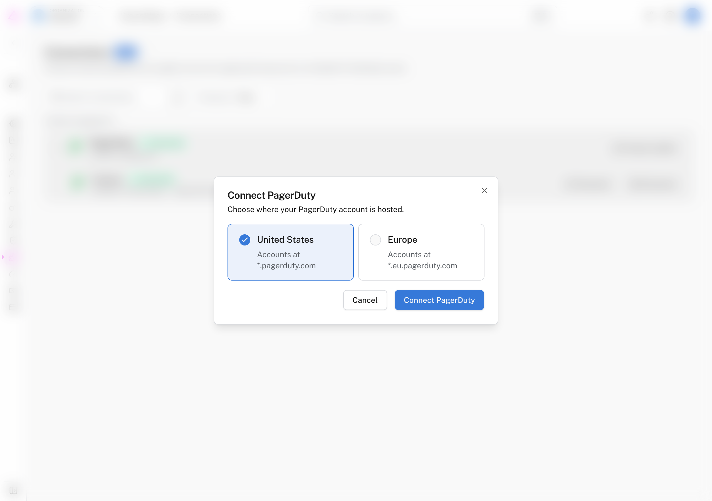
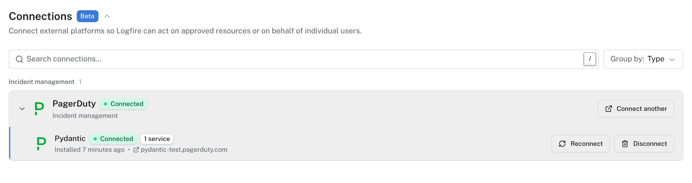
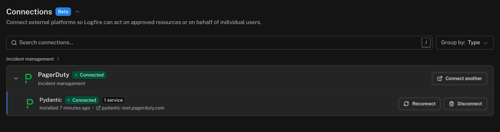
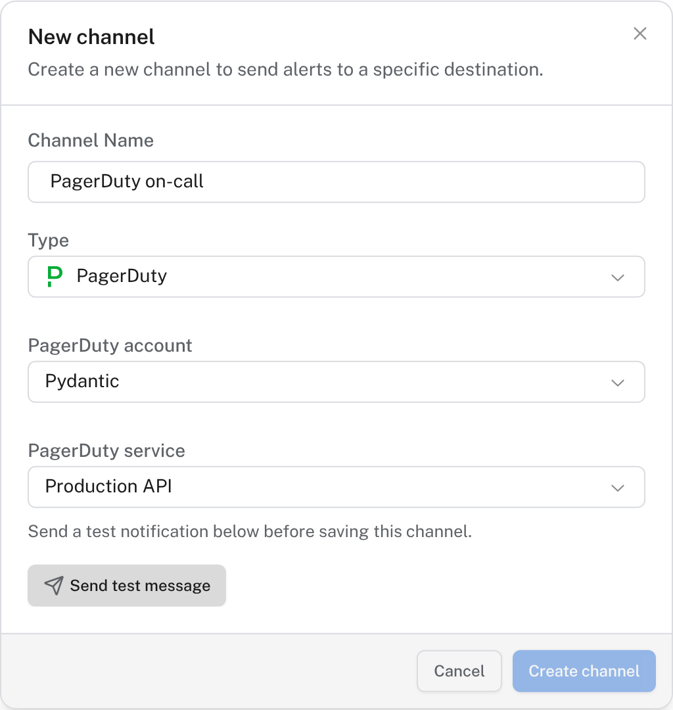
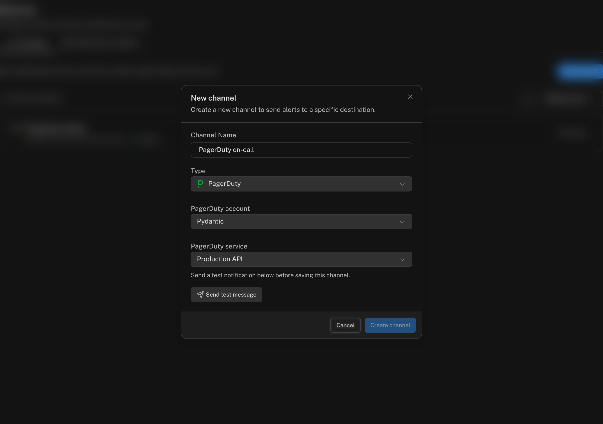

# PagerDuty + Logfire Integration Guide

Page the right on-call team when a [Logfire alert](../guides/web-ui/alerts.md) fires, then resolve the PagerDuty incident automatically when the alert clears.

!!! info "Experimental"
    The PagerDuty integration is experimental and available to selected Logfire organizations. Email [engineering@pydantic.dev](mailto:engineering@pydantic.dev) if you want to try it.

## PagerDuty + Logfire Integration Benefits

- Notify on-call responders when a Logfire alert fires.
- Route each Logfire notification channel to one PagerDuty service.
- Send the alert name, severity, timestamp, Logfire organization and project, and a link back to Logfire with every incident. Notifications can also include the alert description, query results, or delivery errors.
- Resolve the PagerDuty incident automatically when the Logfire alert stops matching.
- Use PagerDuty accounts hosted in the United States or Europe.

## How it Works

- You connect a PagerDuty account once, at the Logfire organization level. During the connection, you choose the PagerDuty services that Logfire may notify.
- A Logfire notification channel points to one approved PagerDuty service. Every project in the organization can attach the channel to its alerts.
- When an alert fires, Logfire sends a trigger event to the service through PagerDuty Events API v2. PagerDuty opens a new incident, or groups the event into the open incident for the same alert.
- When a later alert run finds no matches, Logfire sends a resolve event. PagerDuty resolves the same incident.
- Logfire uses a stable deduplication key for each alert. So a firing notification and its recovery always update the same incident.

## Requirements

- **In Logfire:** permission to change organization settings, usually as an organization owner or admin.
- **In PagerDuty:** permission to add integrations to each service you want Logfire to use.
- **A PagerDuty service:** use a test service with a quiet escalation policy while you verify the connection.

## Support

If you need help with this integration, email [engineering@pydantic.dev](mailto:engineering@pydantic.dev) or ask in the [Pydantic Logfire Slack](https://pydantic.dev/docs/logfire/join-slack/). See [Getting help with Pydantic Logfire](../help.md) for more options.

## Integration Walkthrough

The connection starts in Logfire. PagerDuty asks you to approve the services during the connection, so you do not copy an integration key by hand.

### In Logfire: connect PagerDuty

1. Open your organization's **Settings**, then **Connections**.
2. Find **PagerDuty** and click **Connect**.
3. Choose the region where your PagerDuty account is hosted, then click **Connect PagerDuty**.

    

### In PagerDuty: approve the services

1. PagerDuty opens the Logfire app installation page. Select the services that Logfire may notify.
2. Approve the installation. PagerDuty returns you to the Logfire **Connections** page.
3. Expand **PagerDuty** and confirm that the account shows **Connected** and the expected number of approved services.

<!-- ladle-screenshot story="product--organization-settings--connections--pager-duty-connected" image="../images/guide/pagerduty-connected" alt="The Logfire Connections page showing a connected PagerDuty account with one approved service" viewport="1280x600" scale="2" aspect="1280:340" padding="16" time="2026-09-19T12:07:00Z" -->

<!-- /ladle-screenshot -->

For each service you approve, Logfire receives a key that lets it send alerts and resolve incidents for that service. Logfire encrypts these keys at rest. It does not request access to read or manage other PagerDuty data.

### In Logfire: create a PagerDuty notification channel

A notification channel is an organization-level destination that you attach to one or more alerts.

1. Open **Project settings** → **Notifications** → **Delivery** → **Channels**.
2. Click **New channel**.
3. Enter a name that explains who receives the page, such as `PagerDuty on-call`.
4. Select **PagerDuty** as the type.
5. Select the connected PagerDuty account and service.

<!-- ladle-screenshot story="product--project-settings--delivery--channel-detail--new-pager-duty-channel-dialog" image="../images/guide/pagerduty-channel" alt="The New channel dialog with a PagerDuty account and service selected" viewport="1280x900" scale="2" aspect="1280:900" padding="0" -->

<!-- /ladle-screenshot -->

6. Click **Send test message**.
7. Confirm that the test incident appears on the selected PagerDuty service, then resolve it in PagerDuty.
8. Return to Logfire and click **Create channel**.

!!! warning "A test message opens a real incident"
    PagerDuty may notify the service's on-call responders. Use a test service or temporarily choose low-urgency notifications before you send the message.

Logfire requires a successful test before it creates the channel. This catches removed service integrations and invalid credentials before a production alert needs them.

### In Logfire: send an alert to PagerDuty

1. Open **Alerts** from your project's sidebar.
2. Create a new alert or edit an existing alert.
3. Under **Send notifications to**, select the PagerDuty channel.
4. Save the alert.

One notification channel can serve alerts across projects in the same organization. One alert can also notify several channels.

### Verify the incident lifecycle

Trigger the alert with test data and check both systems:

1. PagerDuty opens one incident on the selected service.
2. The incident title matches the Logfire alert name and includes a link back to Logfire.
3. The Logfire alert run history records a successful delivery.
4. When the alert stops matching, a later clean run resolves the same PagerDuty incident.

### Add or replace approved services

Return to **Settings** > **Connections**, expand **PagerDuty**, and click **Reconnect**. Select the complete set of services that Logfire should use.

Existing channels keep their current service reference. If you remove a service from the PagerDuty app installation, update or delete every Logfire channel that uses it.

## How to Uninstall

1. Resolve any open PagerDuty incidents created by Logfire.
2. Delete the Logfire notification channels that use the connection.
3. Open your organization's **Settings** > **Connections**.
4. Expand **PagerDuty** and click **Disconnect**.
5. In PagerDuty, open each approved service and remove the Logfire integration if you no longer need it.

Disconnecting removes the encrypted service keys and approved service references from Logfire. It does not delete the service integration in PagerDuty.

## Troubleshooting

**The PagerDuty account is not available when I create a channel.** Connections are organization-specific. Confirm that you connected PagerDuty to the same organization that owns the project, then reopen the channel form.

**A PagerDuty service is missing.** Reconnect PagerDuty under **Settings** > **Connections** and approve the service. Confirm that you selected the region that matches the account's PagerDuty domain.

**The test message fails.** The service integration may have been removed or its key may no longer be valid. Reconnect the account, select the service again, and retry the test.

**Disconnect is blocked.** Resolve open incidents and delete every Logfire notification channel that uses the connection, then disconnect again.

If none of these steps help, see [Support](#support).
