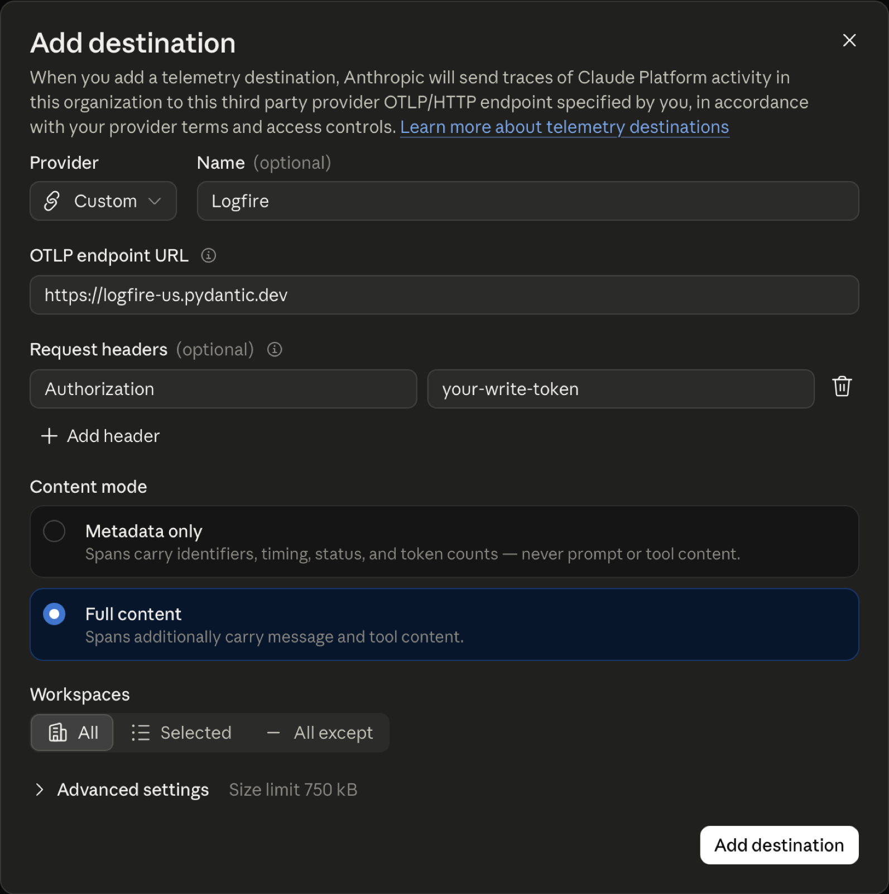
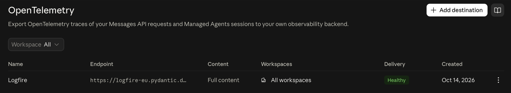
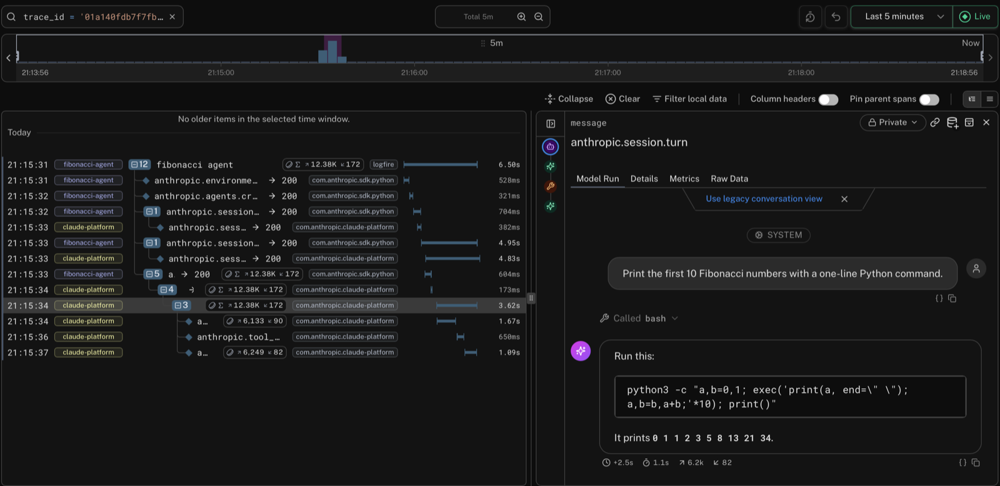
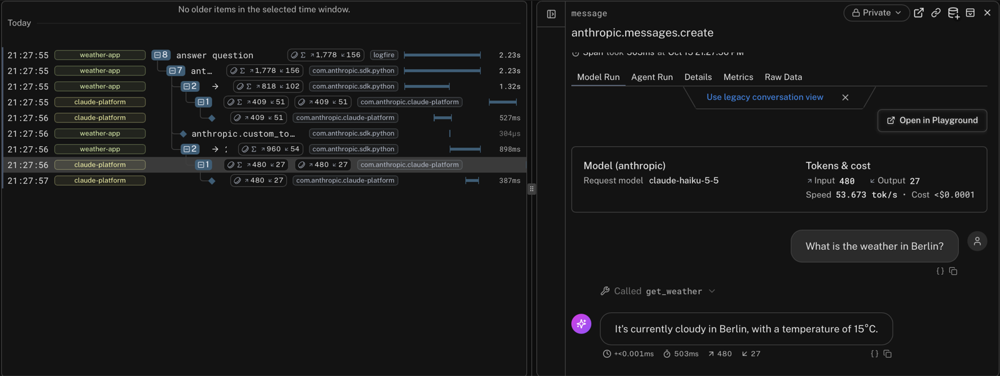

# Send Claude Platform traces to Logfire

See what Claude did for each request your app sends: every Claude Managed Agents turn, each model call, each tool the agent ran, and the tokens it used.

There are two parts:

1. **Add Logfire in the Claude Console.** Anthropic then sends Claude's spans to Logfire for every request, from any language, with no code changes. A span is one unit of work, such as a model call, with a name, a start, and a duration.
2. **Optional: link them to your app.** Add `logfire.configure()` to your Python app, and Claude's spans appear inside your own traces (the full journey of one request, made of nested spans).

!!! note "Beta"
    Sending traces from the Claude Platform is in beta at Anthropic. Span names and attributes can change during the beta.

## What you'll see

| Span | What it shows |
| --- | --- |
| `anthropic.session.turn` | One Managed Agents turn: the conversation, including the system prompt and tool calls. |
| `anthropic.tool_use <tool>` | A tool the agent ran, such as `bash` or web search, with its input and output. |
| `anthropic.messages.create` | One Messages API request: the prompt and the response. |
| `anthropic.model_request` | One model call: the model, token usage, and timing. It has no prompt or response. |

Claude's spans have the service name `claude-platform`. Spans from your own app have your app's service name.

!!! warning "Prompts and responses are sent to Logfire"
    With **Full content**, spans include prompts, responses, and tool inputs and outputs. Anthropic sends them to Logfire directly, so Logfire's [scrubbing](../../how-to-guides/scrubbing.md) (which hides sensitive values before your app sends them) doesn't apply. Choose **Metadata only** to leave out prompts, responses, and tool inputs and outputs. These spans count toward your Logfire usage like any other span.

## Before you start

You need:

- A Logfire project and a [write token](../../how-to-guides/create-write-tokens.md) (the credential that lets a service send data to a project), from **Settings → Write tokens** in your project.
- The **admin** role in your organization in the [Claude Console](https://platform.claude.com). This is the organization that owns your API keys, which is separate from any claude.ai organization.

## Step 1: Add Logfire in the Claude Console

1. Open the Console's [OpenTelemetry settings](https://platform.claude.com/settings/telemetry-destinations) and click **Add destination**.
2. Leave **Provider** as **Custom**, and set **Name** to `Logfire`.
3. Set **OTLP endpoint URL** to the address of your Logfire [data region](../../reference/data-regions.md). Don't add a path: the Console adds it.

    === "US"

        ```text
        https://logfire-us.pydantic.dev
        ```

    === "EU"

        ```text
        https://logfire-eu.pydantic.dev
        ```

4. Under **Request headers**, add a header named `Authorization` with your write token as the value. Paste the token on its own, without `Bearer` in front.
5. Choose a **Content mode**: **Full content** to read conversations in Logfire, or **Metadata only** to leave them out.
6. Under **Workspaces**, choose which Claude workspaces send spans: **All**, **Selected**, or **All except**.
7. Click **Add destination**.

<figure markdown="span">
  { width="600" }
</figure>

**Check it:** open the destination's **⋮** menu and click **Test**. An `anthropic.test` span appears in Logfire's [Live view](../../guides/web-ui/live.md) within about a minute. After your next real request, the **Delivery** column shows **Healthy**.

<figure markdown="span">
  { width="700" }
</figure>

That's all you need to see Claude's spans in Logfire. Each request shows up as its own trace.

## Step 2: Link Claude's spans to your app

This step puts Claude's spans inside the trace of the code that made the call, so you can see which user request or job asked Claude for what.

Install `logfire` and the Claude SDK (version 1.14.0 or later):

```bash
pip install logfire anthropic
```

Call `logfire.configure()` before you create the client. You don't need any other setup.

=== "Claude Managed Agents"

    ```python hl_lines="5 7" skip-run="true" skip-reason="external-connection"
    from anthropic import Anthropic

    import logfire

    logfire.configure()

    client = Anthropic(open_telemetry={'traces': {'content_mode': 'content'}})

    with logfire.span('fibonacci agent'):
        environment = client.beta.environments.create(
            name='fibonacci-env',
            config={'type': 'cloud', 'networking': {'type': 'limited', 'allow_package_managers': True}},
        )
        agent = client.beta.agents.create(
            name='Fibonacci agent',
            model='claude-sonnet-5-5',
            system='You are a helpful coding assistant. Keep replies short.',
            tools=[{'type': 'agent_toolset_20260401'}],
        )
        session = client.beta.sessions.create(agent=agent.id, environment_id=environment.id)

        with client.beta.sessions.events.stream(session.id) as stream:
            client.beta.sessions.events.send(
                session.id,
                events=[
                    {
                        'type': 'user.message',
                        'content': [
                            {'type': 'text', 'text': 'Print the first 10 Fibonacci numbers with a one-line Python command.'}
                        ],
                    }
                ],
            )
            for event in stream:
                if event.type == 'agent.message':
                    print(''.join(block.text for block in event.content if block.type == 'text'))
                elif event.type == 'session.status_idle':
                    break
    ```

    The agent runs the command in its sandbox and replies with something like:

    ```text
    Output: `0 1 1 2 3 5 8 13 21 34`
    ```

=== "Messages API"

    ```python hl_lines="5 7" skip-run="true" skip-reason="external-connection"
    from anthropic import Anthropic, beta_tool

    import logfire

    logfire.configure()

    client = Anthropic(open_telemetry={'traces': {'content_mode': 'content'}})


    @beta_tool
    def get_weather(city: str) -> str:
        """Get the current weather for a city.

        Args:
            city: The city name, for example Berlin.
        """
        return f'Cloudy, 15°C in {city}'


    with logfire.span('answer question'):
        runner = client.beta.messages.tool_runner(
            model='claude-haiku-5-5',
            max_tokens=1024,
            tools=[get_weather],
            messages=[{'role': 'user', 'content': 'What is the weather in Berlin?'}],
        )
        for message in runner:
            pass
        print(message.content[-1].text)
    ```

    Claude calls `get_weather` in your app, then replies with something like:

    ```text
    It's currently cloudy in Berlin, with a temperature of 15°C.
    ```

`open_telemetry={'traces': {'content_mode': 'content'}}` adds prompts and responses to your app's spans too. Leave it out to keep them to metadata only, unless the environment variable `ANTHROPIC_OPEN_TELEMETRY_TRACES_CONTENT_MODE` is set to `content`.

Good to know:

- **Web apps:** if you already [instrument your web framework](../web-frameworks/index.md), Claude's spans appear under each incoming request, for example `GET /chat`, with no extra code.
- **Sampling:** if you [sample](../../how-to-guides/sampling.md) traces in `logfire.configure()`, Claude follows your choice. A trace you don't keep has no Claude spans.

### Group calls into a conversation

Give related calls the same `conversation_id`. The SDK records it as `gen_ai.conversation.id` on your app's spans. It is sent in both content modes, so don't put personal data in it.

```python hl_lines="8" skip-run="true" skip-reason="external-connection"
from anthropic import Anthropic

import logfire

logfire.configure()

client = Anthropic()
conversation = client.with_options(open_telemetry={**client.open_telemetry, 'conversation_id': 'conv_42'})

conversation.messages.create(
    model='claude-haiku-5-5',
    max_tokens=100,
    messages=[{'role': 'user', 'content': 'Hello, Claude'}],
)
```

### Without the Claude SDK

Claude reads your trace context from the `traceparent` request header. If you call the API with `httpx`, [`logfire.instrument_httpx()`](../http-clients/httpx.md) adds that header for you. Install the `httpx` extra first:

```bash
pip install 'logfire[httpx]'
```

Then:

```python hl_lines="8" skip-run="true" skip-reason="external-connection"
import os

import httpx

import logfire

logfire.configure()
logfire.instrument_httpx()

with logfire.span('summarize'):
    response = httpx.post(
        'https://api.anthropic.com/v1/messages',
        headers={
            'x-api-key': os.environ['ANTHROPIC_API_KEY'],
            'anthropic-version': '2023-06-01',
        },
        json={
            'model': 'claude-haiku-5-5',
            'max_tokens': 100,
            'messages': [{'role': 'user', 'content': 'Hello, Claude'}],
        },
        timeout=60,
    )
    print(response.json()['content'][0]['text'])
```

With another HTTP client, add the header yourself with `opentelemetry.propagate.inject(headers)` before you send the request.

## See it in Logfire

Run an example, then open the [Live view](../../guides/web-ui/live.md). Within about a minute you should see your trace. Expand it to see your app's spans with Claude's spans under them. Click a span to read the conversation, with the model, tokens, and cost.

A Managed Agents session, with the turn open:

<figure markdown="span">
  { width="800" }
</figure>

A Messages API request, with the second call open after the tool ran:

<figure markdown="span">
  { width="800" }
</figure>

## Find what you need with SQL

Use the [Explore view](../../guides/web-ui/explore.md) to query Claude's spans.

**All spans of one session.** A session can be spread over several traces, for example when you send a later message from a new request:

```sql
SELECT start_timestamp, span_name, duration
FROM records
WHERE attributes->>'anthropic.session.id' = 'sesn_...'
ORDER BY start_timestamp
```

**One request.** Each response has a `request-id` header. Find its spans with:

```sql
SELECT trace_id, span_name, service_name
FROM records
WHERE attributes->>'anthropic.request.id' = 'req_...'
```

**Token usage.** The same tokens are recorded on more than one span of a request: on your app's span, on Claude's request span, and on the model call. To count each token once in SQL, add up only the model calls, context compactions, and (for Managed Agents) outcome evaluations:

```sql
SELECT
  trace_id,
  sum((attributes->>'gen_ai.usage.input_tokens')::int) AS input_tokens,
  sum((attributes->>'gen_ai.usage.output_tokens')::int) AS output_tokens
FROM records
WHERE span_name IN ('anthropic.model_request', 'anthropic.compaction', 'anthropic.session.outcome_evaluation')
GROUP BY trace_id
```

## Troubleshooting

| Problem | Fix |
| --- | --- |
| No **Add destination** button | Clear the **Workspace** filter at the top of the page with its **×**. The button only shows when no workspace is selected. Also check that you have the admin role. |
| **Delivery** shows **Failing** (401 or 403) | The write token is wrong. Paste a valid token for this project, without `Bearer`. |
| **Delivery** shows **Failing** (404) | The endpoint has a path. Use only `https://logfire-us.pydantic.dev` or `https://logfire-eu.pydantic.dev`. |
| **Delivery** shows **Disabled** | Anthropic turns a destination off after 24 hours of failed deliveries. Fix the cause, then click **Enable** in its **⋮** menu. Spans from while it was off aren't sent later. |
| **Test** works but your requests don't show up | The destination doesn't include the workspace of your API key. Check its **Workspaces**. |
| Claude's spans aren't inside your app's traces | Call `logfire.configure()` before creating the client, and make calls inside a span. |
| No prompts or responses | The destination is set to **Metadata only**. If your organization has a HIPAA, FERPA, or K-12 data-handling restriction with Anthropic, Claude's spans only contain metadata, whatever the content mode. |
| Calls through Amazon Bedrock don't show up | The Console export only covers the Claude Platform, including Claude Platform on AWS. For Amazon Bedrock, use the [Anthropic integration](anthropic.md#amazon-bedrock). |

## Next steps

- [Set up an alert](../../guides/web-ui/alerts.md) for failed turns or slow tool calls.
- Learn more in Anthropic's [OpenTelemetry guide](https://platform.claude.com/docs/en/manage-claude/opentelemetry) and the [span reference](https://platform.claude.com/docs/en/api/opentelemetry/spans), which lists every span and attribute.
