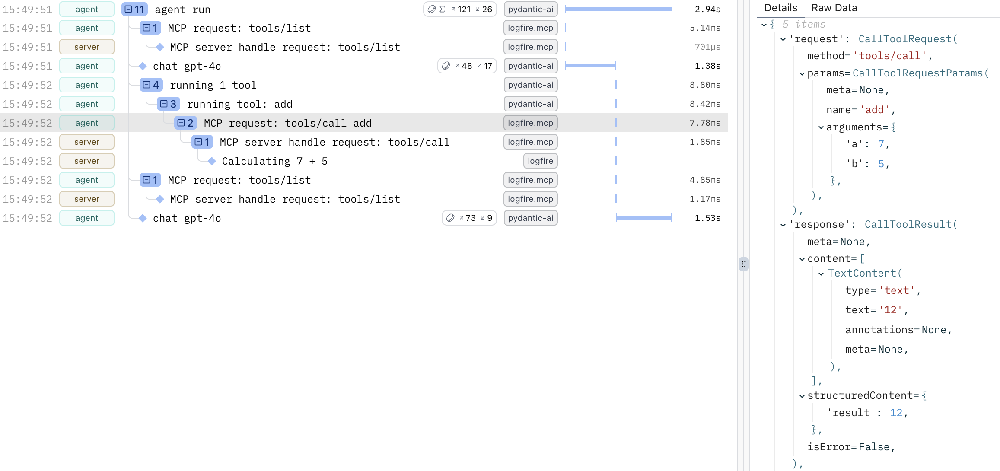

# Model Context Protocol (MCP)

See the calls flowing between your Model Context Protocol (MCP) client and server (the tool a client asked for, the arguments it sent, and the result the server returned) joined into one **trace** (the full journey of one request or agent run, made of nested **spans**, where each span is one unit of work with a name, a start, and a duration) in Logfire, even though the client and server run in separate processes.

The Model Context Protocol is a standard way for an AI application to call tools and fetch data from a separate server. Instrumenting both sides lets Logfire stitch their spans into a single distributed trace: one trace that spans more than one process.

## What you'll capture

- Each client request and each server response as spans, joined into one trace across both processes
- The tool the client called, with the arguments it sent and the result it got back
- The duration of each call and any errors raised on either side

{{ before_you_start() }}

The client example below calls OpenAI using your own API key, so running it costs money on that OpenAI account.

## Installation

Install `logfire`:

{{ install_logfire() }}

The example below also needs the MCP SDK and a client. Install them with:

```bash
pip install 'mcp<2' 'pydantic-ai-slim[mcp,openai]'
```

## Usage

With version 1 of the MCP SDK, call `logfire.configure()`, then [`logfire.instrument_mcp()`][logfire.Logfire.instrument_mcp]. This works on both the client and server side. Calling it in both processes is recommended, so the spans join into one distributed trace. With version 2 of the SDK, or fastmcp 4, `logfire.configure()` alone is enough: see [MCP SDK version 2 and fastmcp 4](#mcp-sdk-version-2-and-fastmcp-4) below.

The example below uses [Pydantic AI](https://pydantic.dev/docs/ai/mcp/client/) as the client (any MCP client works) and OpenAI as the model. To use a different provider, replace `openai:gpt-4o` in the client script with another model name Pydantic AI supports.

First, run the server script:

```python title="server.py" skip-run="true" skip-reason="external-connection"
from mcp.server.fastmcp import FastMCP

import logfire

logfire.configure(service_name='server')
logfire.instrument_mcp()

app = FastMCP()


@app.tool()
def add(a: int, b: int) -> int:
    logfire.info(f'Calculating {a} + {b}')
    return a + b


app.run(transport='streamable-http')
```

Then run this client script in another terminal:

```python title="agent.py" skip-run="true" skip-reason="external-connection"
from pydantic_ai import Agent
from pydantic_ai.mcp import MCPToolset

import logfire

logfire.configure(service_name='agent')
logfire.instrument_pydantic_ai()  # (1)!
logfire.instrument_mcp()

mcp_toolset = MCPToolset('http://localhost:8000/mcp')
agent = Agent('openai:gpt-4o', toolsets=[mcp_toolset])
result = agent.run_sync('What is 7 plus 5?')
print(result.output)
```

1. Instrumenting Pydantic AI is optional, but adds more context to the trace.

## Verify it worked

With both scripts running, open the [Live view](../../guides/web-ui/live.md). Within a few seconds you'll see one trace covering the client request and the server's response to it. Click into it to see the `add` tool call, its arguments, and the result.



## Trace a retry after a tool writes data

A tool can save a change and then fail before the client gets confirmation. If the client retries, pass the same operation ID so the tool can recognize the write it already applied.

The example below uses MCP SDK version 1 and connects the client and server in memory. It runs without a model or a Logfire token. The tool saves one refund to an in-memory ledger, then returns an error on the first call.

```python title="retry.py" skip-run="true" skip-reason="global-instrumentation"
import asyncio

from mcp.server.fastmcp import FastMCP
from mcp.shared.memory import create_connected_server_and_client_session

import logfire

logfire.configure(send_to_logfire=False)
logfire.instrument_mcp()

server = FastMCP('refunds')
ledger: dict[str, int] = {}


@server.tool()
def refund(operation_id: str) -> int:
    """Record a refund once for this operation ID."""
    if operation_id not in ledger:
        ledger[operation_id] = 2000
        raise RuntimeError('Simulated failure after recording the refund')
    return ledger[operation_id]


async def main() -> None:
    """Retry the refund after a simulated error."""
    async with create_connected_server_and_client_session(server) as client:
        arguments = {'operation_id': 'refund-1'}
        with logfire.span('Refund with one retry'):
            first = await client.call_tool('refund', arguments)
            assert first.isError
            retry = await client.call_tool('refund', arguments)
            assert not retry.isError

    assert sum(ledger.values()) == 2000


asyncio.run(main())
```

The trace contains two calls to `refund`. The first returns an error and the second returns the existing refund. The ledger assertion verifies that the total refunded is still $20. In a real tool, store the operation ID and its result durably with the write so deduplication also works after a restart.

To see the trace in Logfire, remove `send_to_logfire=False` and run the example with your Logfire write token configured.

## MCP SDK version 2 and fastmcp 4

Version 2 of the MCP Python SDK (`mcp>=2`, which fastmcp 4 depends on) emits OpenTelemetry spans and passes the trace context between client and server on its own. With it, `logfire.configure()` is all you need on each side, and you get the same joined trace without calling `logfire.instrument_mcp()`. Calling it anyway does nothing except emit a warning saying it's unnecessary.

The examples on this page target version 1 of the SDK, which is why the install command above pins `mcp<2`: `mcp.server.fastmcp` no longer exists in version 2, where the same server class is `mcp.server.mcpserver.MCPServer`.

## Troubleshooting

Not seeing data? Check that `logfire.configure()` ran in each process and that your write token is set. With version 1 of the SDK, also check that `instrument_mcp()` ran after `logfire.configure()`, exactly once per process. Only seeing one side of the trace? Make sure both the client and the server are set up as above.

## Reference

- API reference: [`logfire.instrument_mcp()`][logfire.Logfire.instrument_mcp]
- [MCP Python SDK](https://github.com/modelcontextprotocol/python-sdk)
