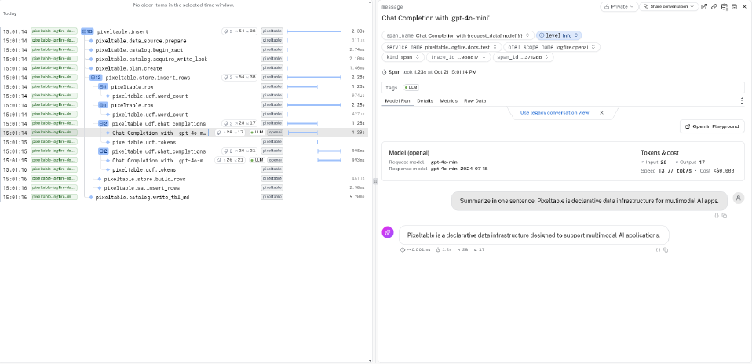

# Pixeltable

See the work [Pixeltable][pixeltable] does for your tables alongside the LLM calls it makes. Pixeltable is declarative data
infrastructure for multimodal AI apps: you define tables and **computed columns** (columns whose values come from a
model or a Python function), and Pixeltable calls the models when rows are inserted or updated, then stores the results.

Pixeltable has **native OpenTelemetry** tracing in the `opentelemetry-instrumentation-pixeltable` package.
OpenTelemetry (OTel) is the open industry standard for collecting traces, metrics, and logs. Each Pixeltable
operation becomes one **trace** (the full journey of that operation, made of nested **spans**, each a single unit of work
with a name, a start, and a duration). Once [`logfire.configure()`][logfire.configure] sets **Logfire** as the global
tracer provider, Pixeltable's spans flow to **Logfire** with no extra exporter.

## What you'll capture

- One trace per Pixeltable operation: `insert`, `update`, `add_computed_column`, `collect`, `create_table`, and more
- A span per user-defined function (UDF) call, and per row for the first 100 rows of each operation, with attributes
  such as `pxt.table_id`,
  `pxt.num_rows`, `pxt.column`, and `pxt.udf_path`
- With [`logfire.instrument_openai()`][logfire.Logfire.instrument_openai], the OpenAI calls made by computed columns,
  nested under the UDF span that made them, with model, messages, token counts, and cost

{{ before_you_start() }}

## Install Logfire and Pixeltable

Install `logfire`:

{{ install_logfire() }}

Install Pixeltable, its OpenTelemetry instrumentation, and the `openai` package that the example's computed column uses.
Logfire brings its own OpenTelemetry SDK, so the `pixeltable[otel]` extra's SDK and exporters are not needed here:

```bash
pip install pixeltable opentelemetry-instrumentation-pixeltable openai
```

## Trace a table

!!! warning "Prompts and completions are sent to Logfire"
    `logfire.instrument_openai()` records message content. Use [scrubbing](../../how-to-guides/scrubbing.md) to
    redact sensitive values before they leave your machine.

Call `logfire.configure()`, `logfire.instrument_openai()`, and `PixeltableInstrumentor().instrument()` before the first
Pixeltable operation:

```python skip-run="true" skip-reason="external-connection" hl_lines="1 3 4 6 8"
import logfire

logfire.configure()
logfire.instrument_openai()

from opentelemetry.instrumentation.pixeltable import PixeltableInstrumentor

PixeltableInstrumentor().instrument(span_level='debug')

import pixeltable as pxt
from my_udfs import word_count
from pixeltable.functions import openai

t = pxt.create_table('articles', {'id': pxt.Int, 'body': pxt.String}, if_exists='replace_force')
t.add_computed_column(words=word_count(t.body))
t.add_computed_column(
    summary=openai.chat_completions(
        messages=[{'role': 'user', 'content': 'Summarize in one sentence: ' + t.body}],
        model='gpt-4o-mini',
    ).choices[0].message.content
)
t.insert([
    {'id': 1, 'body': 'Pixeltable is declarative data infrastructure for multimodal AI apps.'},
    {'id': 2, 'body': 'Logfire is an observability platform built on OpenTelemetry.'},
])
print(t.select(t.id, t.words, t.summary).collect())
```

Pixeltable does not allow UDFs in the `__main__` module of a script, so the custom UDF lives in its own module:

```python title="my_udfs.py" skip-run="true" skip-reason="external-connection"
import pixeltable as pxt


@pxt.udf
def word_count(text: str) -> int:
    return len(text.split())
```

`span_level='debug'` adds per-row spans (up to 100 per operation) and per-UDF-call spans, so each OpenAI span nests
under the `pixeltable.udf.chat_completions` span that made it. The default, `'info'`, keeps operation, catalog, store,
and SQL spans, so the OpenAI spans nest under `pixeltable.store.insert_rows` instead.

## Verify it worked

Open the [Live view](../../guides/web-ui/live.md). You should see a `pixeltable.insert` trace with
`pixeltable.store.insert_rows`, two `pixeltable.row` spans with `pixeltable.udf.word_count` under them, and two
`pixeltable.udf.chat_completions` spans, each with a `Chat Completion with 'gpt-4o-mini'` span under it. The
`create_table`, `add_computed_column`, and `collect` calls each appear as their own trace.

The example above looks like this in Logfire:

<figure markdown="span">
  
  <figcaption>The `pixeltable.insert` trace. The OpenAI chat completion is nested under `pixeltable.udf.chat_completions`, with the model, token counts, and cost.</figcaption>
</figure>

## Troubleshoot missing spans

- **No Pixeltable spans appear:** call `PixeltableInstrumentor().instrument()` before the first Pixeltable operation,
  in the same process as `logfire.configure()`.
- **No OpenAI spans under the UDF spans:** call `logfire.instrument_openai()` before the first insert. Computed-column
  results are stored, so `collect()` doesn't call the model again. OpenAI spans appear on `insert`, `update`, and
  when `add_computed_column` fills existing rows.
- **No data appears in Logfire:** check that your write token (the credential your deployed app uses to send
  data to a Logfire project) is set. Run `logfire projects use <your-project>` locally, or set the
  `LOGFIRE_TOKEN` environment variable in production.

## Next steps

- [Pixeltable observability guide](https://docs.pixeltable.com/platform/observability): span levels, the full span
  tree, and Pixeltable's OpenTelemetry metrics
- [Pixeltable documentation](https://docs.pixeltable.com)

[pixeltable]: https://github.com/pixeltable/pixeltable
