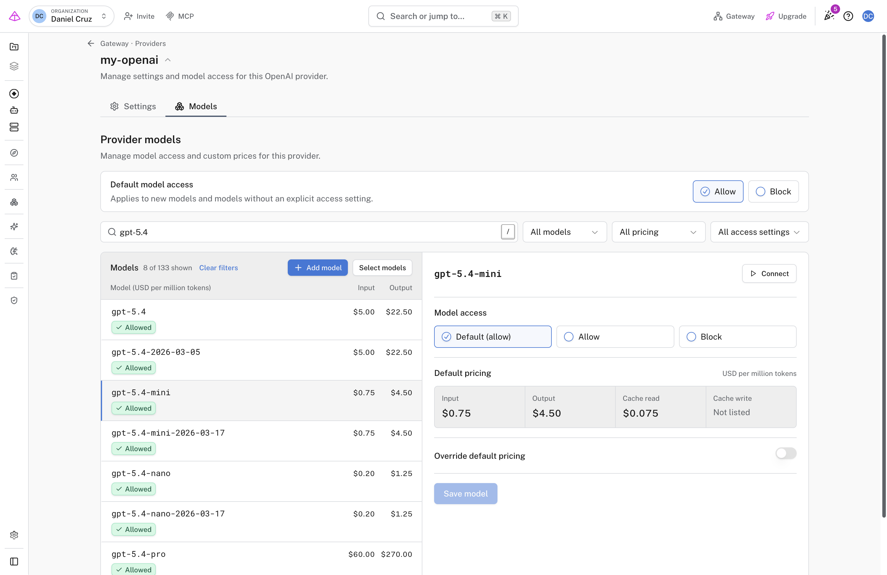
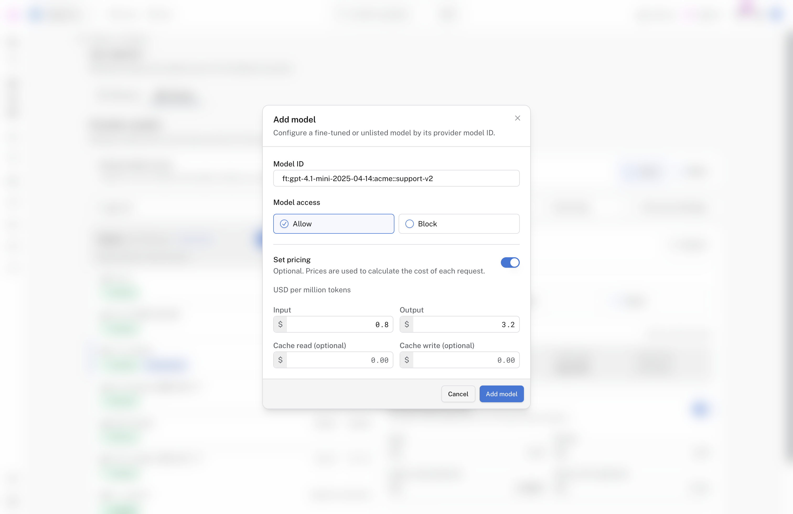
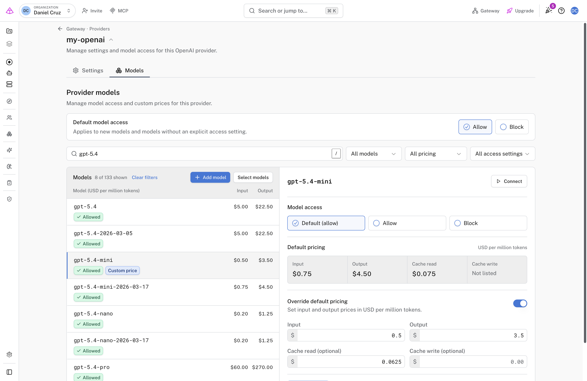

# Control Gateway model access and pricing

Choose which models your applications can call through each Gateway provider, and track costs at your own rates. Each provider has a **Models** tab where you allow or block models, add fine-tuned or unlisted models, and, on a [bring-your-own-key (BYOK) provider](byok-providers.md) (one that uses your own upstream account and credentials), override the price Gateway uses to calculate cost. Built-in providers support access settings only.

You do not need the **Models** tab to send requests: every model a provider serves is allowed until you change it. Access settings apply to every request routed through that provider, whichever API key or [gateway endpoint](endpoints.md) the request uses. You need organization-admin access to change them.

!!! note "Early Access: Growth, Enterprise, or self-hosted"
    Model access and pricing is in Early Access, which is available on Growth and Enterprise plans and on self-hosted deployments. To see the **Models** tab, open [**Settings → Early access**](https://logfire.pydantic.dev/settings/early-access) and turn on **AI Gateway model access & pricing**. The first time you turn on an Early Access feature, you are asked to accept the Early Access terms. This choice applies to your account in this browser.

## Allow or block models

1. Open [**AI Engineering → Gateway → Providers**](https://logfire.pydantic.dev/-/redirect/default-org/-/gateway/providers), check the selected organization, click **Edit** on a provider, and open the **Models** tab. The list shows each model the provider serves, with its access and price.

   <div align="center">

   [](../../../images/guide/ai-gateway/model-access-models-tab.png)

   *Every model follows **Default model access** until you give it its own setting.*

   </div>

2. Select a model. Under **Model access**, choose **Allow** or **Block**, then click **Save model**. The first option, for example **Default (allow)**, removes the model's own setting so it follows the default again. To change several models at once, click **Select models**.

**Default model access** applies to models without their own setting, including models the provider adds later. **Allow**, the default, permits every model you have not blocked. **Block** permits only the models you allow, which turns the list into an allow-list.

!!! warning "Switching the default to Block rejects requests immediately"
    Requests to every model without its own **Allow** fail as soon as you confirm, including models your applications already use. Allow the models you need first, then change the default.

A request for a blocked model fails with `403`:

```
Access to model `gpt-5.4-mini` is disabled for this provider. An organization admin can change this under Gateway → Providers → Models.
```

## Add a fine-tuned or unlisted model

If the provider doesn't list a model, such as your own fine-tuned model, add it by ID.

1. On the **Models** tab, click **Add model**. Enter the **Model ID** exactly as your application sends it, for example `ft:gpt-4.1-mini-2025-04-14:acme::support-v2`.
2. Choose **Model access**. On a BYOK provider, turn on **Set pricing** to enter prices, as described in the next section.
3. Click **Add model**. The model appears in the list with a **Custom model** label.

   <div align="center">

   [](../../../images/guide/ai-gateway/model-access-add-model.png)

   *A fine-tuned model with its own prices. Without a price, Gateway can't calculate the model's cost.*

   </div>

## Set custom prices on a BYOK provider

Gateway calculates each request's cost from its token counts (a token is the unit models read and bill by; a few characters of text) and a price in USD per million tokens. By default it uses the **catalog price** from Gateway's model catalog. That cost counts toward [spending limits and policies](spending-policies.md). A custom price replaces the catalog price for one model on one provider. Use it when you pay a negotiated rate or when the catalog has no price for the model. It changes only the cost Gateway records; your provider still bills you directly.

1. Select a model. **Default pricing** shows its catalog price, if any.
2. Turn on **Override default pricing**, or **Set pricing** when there is no catalog price.
3. Enter **Input** and **Output** prices. **Cache read** and **Cache write** price tokens served from or written to the provider's prompt cache; they are optional, and empty values use the input price.
4. Click **Save model**. The model shows a **Custom price** badge.

   <div align="center">

   [](../../../images/guide/ai-gateway/model-access-price-override.png)

   *A custom price on `gpt-5.4-mini`, replacing the catalog price shown under **Default pricing**.*

   </div>

OpenAI and Anthropic answer a request for a model name with a dated version of that name. For example, OpenAI answers `gpt-5.4-mini` as `gpt-5.4-mini-2026-03-17`. A custom price on `gpt-5.4-mini` also applies to those responses. If both names have a custom price, the dated name's price applies. If the provider answers with a name that is not a dated version, such as `claude-3-7-sonnet-latest` answered as `claude-3-7-sonnet-20250219`, Gateway uses the custom price of the model in the response, or its catalog price if it has none.

To return to the catalog price, turn the override off and click **Save model**. Built-in providers always use the catalog price.

## Verify it worked

Open **Playground** from the sidebar, choose the provider and model, and send a short message. The Playground needs a project API key; if it shows **project key required**, click **Create project key** first.

- An allowed model answers. A blocked model still appears in the model list, but the request returns the `403` error above.
- For a custom price, send a request, then open [**AI Engineering → Gateway → API Keys**](https://logfire.pydantic.dev/-/redirect/default-org/-/gateway/api-keys), select the key you used, and check **Usage & Spending Limits**. The cost should match your price, not the catalog price. The cost estimate shown in the Playground uses catalog prices, so don't use it to check a custom price.

## Troubleshooting

- **A model is rejected unexpectedly:** check the model's own setting, then **Default model access**. With the default set to **Block**, every model you have not allowed is rejected, including newly released ones.
- **A blocked model still works:** check which provider handled the request. Settings are per provider, so an endpoint can still reach the model through another provider.
- **No pricing data error:** the provider has **Require pricing data** turned on in its **Settings** tab and the model has no price. Set a custom price, or turn that setting off.
- **Batch or file requests fail with `403`:** on a BYOK provider that blocks any model, Gateway rejects requests whose model it can't read, such as requests it passes through without parsing.
- **A custom price is ignored:** check which model the response reports. The Playground shows it under each reply. If it is not the model you requested or a dated version of it, set the price on the reported model ID.
- **Costs look wrong:** prices are per **million** tokens. Check whether cache prices are set; empty ones use the input price.

To cap what the allowed models can spend, [set spending limits](spending-policies.md).
