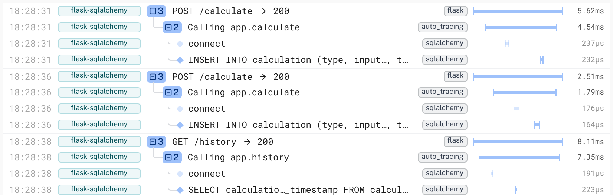
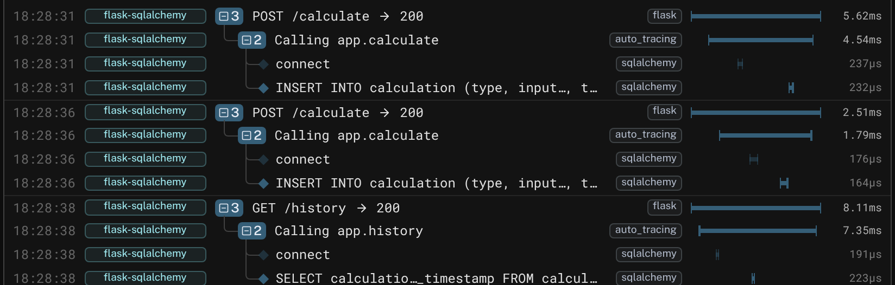

# Examples

These are working, standalone applications and projects that you can clone, run
locally, and experiment with to explore Logfire's various capabilities.

**Have a suggestion?**

If you'd like to see an example in a particular language or using a specific
library, [get in touch](../help.md).

## Python

### Flask and SQLAlchemy Example

This example demonstrates a simple Python financial calculator application built
with Flask and SQLAlchemy. It's instrumented using the appropriate integrations
and [auto-tracing](../guides/onboarding-checklist/add-auto-tracing.md). When you
run the server locally and interact with the calculator, you'll see traces being
automatically generated:

<!-- ladle-screenshot story="product--live--docs-traces--core-sdk--flask-sqlalchemy" image="../images/logfire-screenshot-examples-flask-sqlalchemy" alt="Flask and SQLAlchemy example" viewport="850x420" scale="2" selector=".live-view-row" aspect="1692:540" padding="4" time="2025-09-25T18:30:00Z" -->

<!-- /ladle-screenshot -->

<a href="https://github.com/pydantic/logfire/tree/main/examples/python/flask-sqlalchemy/" target="_blank" rel="noopener">View on GitHub :material-open-in-new:</a>

## JavaScript/TypeScript

Logfire provides a TypeScript SDK that enables instrumentation of JavaScript/TypeScript applications.
For implementation details and examples, please refer to the
[TypeScript SDK getting started guide](https://pydantic.dev/docs/logfire/instrument/typescript/get-started/).
